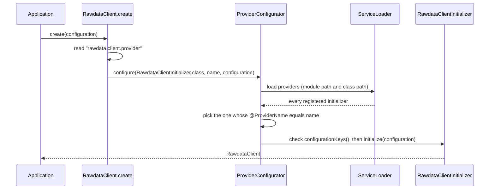

# rawdata-client-api

The API every application codes against: `RawdataClient` and the producers, consumers, messages, cursors and metadata
clients it creates, the UUIDv7 ids that order a topic, and the provider service that turns a configuration map into a
client. It also holds two providers that need no store, `memory` and `discard`, a copy helper, and the base classes
that the `postgres` provider and the Avro engine build on.

You always need this module. Your code depends on it alone; the provider that does the storing (`postgres`,
`filesystem`, `gcs`, `s3`) is a runtime dependency, chosen by configuration.

## Coordinates

| | |
|---|---|
| Group | `io.descoped.rawdata` |
| Artifact | `rawdata-client-api` |
| Version | managed by `rawdata-client-bom` |
| JPMS module | `io.descoped.rawdata.api` |
| Exported packages | `io.descoped.rawdata.api`, `io.descoped.rawdata.api.spi` |
| Dependencies | `io.descoped.spi:service-provider-api` (module `io.descoped.service.provider.api`, `requires transitive`) |
| Java | 17 or newer |

```xml
<dependencyManagement>
    <dependencies>
        <dependency>
            <groupId>io.descoped.rawdata</groupId>
            <artifactId>rawdata-client-bom</artifactId>
            <version>3.0.0</version>
            <type>pom</type>
            <scope>import</scope>
        </dependency>
    </dependencies>
</dependencyManagement>

<dependencies>
    <dependency>
        <groupId>io.descoped.rawdata</groupId>
        <artifactId>rawdata-client-api</artifactId>
    </dependency>
</dependencies>
```

On the module path, your module needs one line:

```java
module com.example.app {
    requires io.descoped.rawdata.api;
}
```

`requires transitive` on the service-provider API means you can catch its `ProviderException` without a `requires`
of your own.

## Quick start

The `memory` provider is in this module, so this runs with no store and no other dependency:

```java
import io.descoped.rawdata.api.RawdataClient;
import io.descoped.rawdata.api.RawdataConsumer;
import io.descoped.rawdata.api.RawdataMessage;
import io.descoped.rawdata.api.RawdataProducer;

import java.nio.charset.StandardCharsets;
import java.time.Duration;
import java.util.Map;

public class QuickStart {
    public static void main(String[] args) throws InterruptedException {
        try (RawdataClient client = RawdataClient.create(Map.of(RawdataClient.PROVIDER_KEY, "memory"))) {

            try (RawdataProducer producer = client.producer("invoices")) {
                producer.publish(
                        RawdataMessage.builder()
                                .position("invoice-1001")
                                .put("document", "<invoice id=\"1001\"/>".getBytes(StandardCharsets.UTF_8))
                                .build(),
                        RawdataMessage.builder()
                                .position("invoice-1002")
                                .put("document", "<invoice id=\"1002\"/>".getBytes(StandardCharsets.UTF_8))
                                .build());
            }

            try (RawdataConsumer consumer = client.consumer("invoices")) {
                for (RawdataMessage message : consumer.receiveUpTo(100, Duration.ofSeconds(1))) {
                    System.out.println(message.id() + " " + message.position() + " "
                            + new String(message.get("document"), StandardCharsets.UTF_8));
                }
            }
        }
    }
}
```

It prints one line per message, in the order they were published (your ids differ):

```text
01a1f11a-0a5d-772f-b062-ef03d64c6c18 invoice-1001 <invoice id="1001"/>
01a1f11a-0a5d-7a97-8b79-0cb683ef604c invoice-1002 <invoice id="1002"/>
```

To store the messages for real, add a provider artifact and change the configuration; the code stays the same. The
[tutorial](../tutorial.md) goes on from here.

## Concepts

### Client

A `RawdataClient` is a connection to one store: a database, a folder or a bucket, or the client's own memory. It
makes producers, consumers and metadata clients for topics, finds cursors, and reads a topic's last message. A client
is meant to be shared by the whole process and closed once, at shutdown. It is `AutoCloseable`, and closing it closes
everything it made.

### Provider

A provider is the implementation behind the API for one kind of store. It is found by name at run time, so your code
never names a provider class. Each provider is a `RawdataClientInitializer` (a `ProviderInitializer<RawdataClient>`
from `io.descoped.spi:service-provider-api`) with a `@ProviderName` annotation:

| Provider name | Module | Store |
|---|---|---|
| `memory` | `rawdata-client-api` | the client's memory |
| `discard` | `rawdata-client-api` | none: accepts and drops |
| `postgres` | `rawdata-client-provider-postgres` | PostgreSQL 18 |
| `filesystem` | `rawdata-client-provider-filesystem` | Avro files in a local folder |
| `gcs` | `rawdata-client-provider-gcs` | Avro files in a Google Cloud Storage bucket |
| `s3` | `rawdata-client-provider-s3` | Avro files in an Amazon S3 bucket |

Providers are swappable because every one passes the same contract tests, the TCK (see [Testing](#testing)).

### Topic

A topic is a named, ordered stream of messages, together with a small key-value store of metadata. A topic exists
from its first use: there is no "create topic" call, and an unknown topic reads as empty.

A topic name is 1 to 100 characters of `A-Z a-z 0-9 _ . -`, starting with a letter or a digit, and case matters
(`Invoices` and `invoices` are two topics). [`RawdataTopics`](#rawdatatopics) holds the rule. Why so strict: a
provider puts the name into a table row, a file path or an object name, and refusing everything else (no `/`, no
whitespace, no `..`) keeps a name from escaping its place in any store.

### Message

A `RawdataMessage` is one immutable record in a topic:

| Field | Set by | Meaning |
|---|---|---|
| `id()` | the producer, or you | a UUIDv7; the topic is read in the order of ids |
| `timestamp()` | derived | the millisecond in the id |
| `position()` | you, required | your own identifier of the message in its source system; need not be unique or sortable |
| `orderingGroup()` | you, optional | the name of a sequence that several threads or producers write in parallel |
| `sequenceNumber()` | you, optional | the message's number in its ordering group: 1, 2, 3… without gaps; 0 (the default) when not used |
| `keys()`, `get(key)`, `data()` | you | named binary content, in the order the keys were put |

Build one with `RawdataMessage.builder()`, or start from an existing message with `message.copy()`.
`RawdataMessage` is a sealed interface: the builder is the only way to make one, so a store can keep a message as it
is, and two messages are `equals` when every field and every byte of content are equal.

Content is copied in and out. `put` keeps a copy of your array, and `get` and `data()` return copies, so changing an
array you published or read never changes the message or the store.

The position, the ordering group and the content keys may be any string without the NUL character (U+0000). NUL is
refused because a PostgreSQL text column cannot hold it, and every provider must be able to store the same messages.

### Id and order

Every message has a UUIDv7 id ([RFC 9562](https://www.rfc-editor.org/rfc/rfc9562)), laid out as PostgreSQL 18's
`uuidv7()` lays it out:

```text
 48 bits  unix_ts_ms   milliseconds since 1970-01-01T00:00Z
  4 bits  version      7
 12 bits  rand_a       sub-millisecond fraction
  2 bits  variant      0b10
 62 bits  rand_b       random
```

The time comes first, so ids sort by time. The order of a topic is `RawdataIds.ORDER`: the 128 bits compared as an
unsigned number, as PostgreSQL orders `uuid` values. Never sort ids with `UUID.compareTo`: it compares two signed
`long`s, and gets the order wrong whenever the top bit of either half differs.

```java
ids.sort(RawdataIds.ORDER);            // right
ids.sort(Comparator.naturalOrder());   // wrong for ids: UUID.compareTo is signed
```

- An id the producer assigns is greater than every id already in the topic, also when several messages are made in
  one millisecond and when the clock moves back (see [`RawdataIds.next`](#how-ids-are-assigned)).
- An id you give is kept as it is, in any order, as in 2.x: it may be lower than ids already in the topic. Ids must
  be unique; `memory` replaces a message with the same id.

A consumer of a topic that is still written may miss a message whose id lands behind its position. A completed
topic, read from the beginning, gives every message once (see [Ids and order](../contract.md#ids-and-order)).

### Producer

A `RawdataProducer` publishes on one topic. `publish` takes one or more messages (varargs or a `List`); the messages
of one call are written together, all or none, in the order given. `publishAsync` does the same on the client's
threads and returns a `CompletableFuture<Void>`. A producer may be used from several threads, and a client may have
several producers on a topic: the client keeps them in one order.

### One writer per topic

**Only one process writes a topic.** Within that process, any number of producers of its client may publish. Consumers
may be anywhere. If a second process publishes to the topic anyway, the provider notices: a client remembers where it
last wrote a topic (before its first publish, where the topic ended), and a publish that finds more after that point
throws `RawdataWriterConflictException`, which names the topic. From then on that client keeps failing to publish to
the topic, so two writers never merge into one stream. A new client, created after the other writer stopped, starts
from the topic's current end.

This is a decision, not a limit to work around: nothing supports several processes keeping a common order. `memory`
and `discard` keep nothing a second process could see, so they never throw it.

### Consumer

A `RawdataConsumer` reads one topic in id order, from a starting point, and keeps its own position. It is pulled:
nothing is delivered until you ask, so you take only as much as you can handle. There is no reactive-streams or
`Flow` API.

| Call | Does |
|---|---|
| `receive(timeout, unit)` | the next message, waiting up to the timeout for one to be published; null if none came |
| `receiveUpTo(max, timeout)` | waits up to the timeout for the first message, then takes what is available at once, up to `max` |
| `receiveAsync()` | a future of the next message, completed on the client's threads |
| `seek(timestamp)` | moves the position so the next message is the first whose id time is at or after the timestamp |

A consumer is for one thread at a time, and at most one `receiveAsync` may be outstanding. Make one consumer per
reading thread; they are cheap.

### Cursor

A `RawdataCursor` is a starting point for a consumer, made by the client and specific to its provider. You rarely
need one directly; the `consumer(...)` overloads make it for you:

| Consumer | Starts |
|---|---|
| `consumer(topic)` | at the beginning |
| `consumer(topic, id)` | after the message with that id |
| `consumer(topic, id, true)` | at the message with that id |
| `consumer(topic, position, approxTimestamp, tolerance)` | after the first message with that position written in `[approxTimestamp - tolerance, approxTimestamp + tolerance]` |
| `consumer(topic, position, true, approxTimestamp, tolerance)` | at that message |
| `consumer(topic, cursor)` | at a cursor from `cursorOf`; null for the beginning |

Every id and position argument may be null, which means the beginning.

The id need not be the id of a message: a cursor at an id starts at the first message with a greater id, or an equal
one if inclusive. `RawdataIds.beginningOf(millis)` is the smallest id of a millisecond, so
`cursorOf(topic, RawdataIds.beginningOf(t), true)` starts at the first message written at or after time `t`.

A search by position needs a time window, because a position is your identifier, not the store's: it need not be
unique, and providers do not index it. Give the time you expect the message to have been written, and how far off it
may be. The search is limited to that range, and fails with `RawdataNoSuchPositionException` if no message with the
position is in it.

### Metadata

`client.metadata(topic)` returns a `RawdataMetadataClient`: a small key-value store that belongs to the topic and
lasts as long as the topic's messages. Every metadata client of a topic sees the same entries, also across clients
of a shared store. A typical entry is a consumer's checkpoint, the id of the last message it handled.

| Call | Does |
|---|---|
| `keys()` | an unmodifiable snapshot of the keys |
| `get(key)` | a copy of the value, or null |
| `put(key, value)` | writes, replacing any value; returns the metadata client |
| `remove(key)` | removes; does nothing for a missing key; returns the metadata client |

A key is any string without NUL, the empty string included, and case matters. How long a key may be depends on the
store, but every provider takes at least `RawdataMetadataClient.PORTABLE_KEY_BYTES` (127) bytes of UTF-8. Keep keys
within that and they work everywhere. The per-provider limits are in the [contract](../contract.md#metadata).

### Closed state

After `close()`, every method of a client, and of the producers, consumers and metadata clients it made, throws
`RawdataClosedException`, except `isClosed()` and `close()`, which may be called any number of times. Closing a
producer or a consumer closes only that one. Closing wakes a waiting `receive`, which then throws, and fails a pending
`receiveAsync` or `publishAsync` future with `RawdataClosedException`.

## How it works

### Creating a client



1. `RawdataClient.create(configuration)` reads `rawdata.client.provider` (`RawdataClient.PROVIDER_KEY`). A missing or
   blank value throws `IllegalArgumentException`; a null map throws `NullPointerException`.
2. It calls `ProviderConfigurator.configure(RawdataClientInitializer.class, name, configuration)` from
   `service-provider-api`, which loads every `RawdataClientInitializer` with `ServiceLoader` and reads the
   `@ProviderName` of each class without instantiating it.
3. If no provider has that name, it throws `ProviderException` with the names it found
   (`No provider named 'x'; available: [discard, memory]`). Two providers with one name, or a provider without
   `@ProviderName`, also throw `ProviderException`.
4. It instantiates the chosen initializer and checks that the configuration has every key in its
   `configurationKeys()`; a missing one throws `IllegalArgumentException` naming the keys.
5. It calls `initialize` with an unmodifiable copy of the whole configuration (null keys or values throw
   `NullPointerException`). The provider reads its own keys; `memory` and `discard` read none.

Discovery works on both paths. On the module path, the API module declares `uses RawdataClientInitializer`, so a
provider module that no module `requires` is still resolved at startup. Each provider registers itself both with
`provides` in its `module-info.java` and in `META-INF/services/io.descoped.rawdata.api.RawdataClientInitializer`, so
it is found on the class path too.

### How ids are assigned

A producer finds the topic's last id (or `RawdataIds.beginningOfTime()` for an empty topic) and walks the call's
messages in order. For a message without an id it calls `RawdataIds.next(previous)`:

- it generates an id for now (`RawdataIds.generate()`: the current millisecond, a 12-bit fraction of the
  millisecond, and 62 random bits);
- if that id is greater than `previous`, it is used;
- otherwise (same millisecond and a smaller random part, or a clock that moved back) it uses `previous` plus one,
  carrying from `rand_b` into `rand_a` and then into the timestamp.

A message with an id keeps it if it is greater than `previous`, and the whole call fails otherwise. Each id becomes
`previous` for the next message. So ids in a topic are strictly increasing even when the clock is not, which is what
PostgreSQL 18 does for its own `uuidv7()`. A consequence: after the clock moves back, new ids carry the last time
seen until the clock catches up, so `timestamp()` is "no earlier than the previous message", not a precise wall
clock.

### When a message is visible and durable

| Provider | Visible to consumers and durable |
|---|---|
| `memory` | when `publish` returns (in this client's memory only; gone at `close`) |
| `postgres` | when `publish` returns |
| `filesystem`, `gcs`, `s3` | when the topic's [upload window](rawdata-client-provider-avro.md#upload-window) is uploaded; closing the producer uploads it |
| `discard` | never: nothing is kept |

In every provider, closing a producer makes what it published visible and durable.

### How a receive waits

A consumer never pushes. `receive(timeout, unit)` returns at once if a message is there, and otherwise waits:

- `memory` waits on a condition that each publish to the topic signals, so a receive wakes as soon as a message is
  published.
- `postgres`, `filesystem`, `gcs` and `s3` extend [`PollingRawdataConsumer`](#the-spi-package): a receive reads a
  batch from the store, and if it finds nothing it waits for the provider's poll interval, or until a publish through
  the same client or a close wakes it, and reads again. A message published by another process is seen on the next
  poll.

`receiveUpTo(max, timeout)` calls `receive` with the timeout for the first message, then `receive` with a zero timeout
until it has `max` or nothing more is available. If the consumer is closed or the thread interrupted after the first
message, it returns what it has (with the interrupt flag set again), so a received message is never lost. Timeouts
longer than `Integer.MAX_VALUE` milliseconds (about 24.8 days) are cut to that.

### Copying

`RawdataCopy.copy(from, to, batchSize, idleTimeout)` loops: `from.receiveUpTo(batchSize, idleTimeout)`, then
`to.publish(batch)`, until a receive returns nothing within the idle timeout. It returns the number of messages
copied. Messages keep their ids, so the target has the same order and ids as the source. Memory use is bounded by
one batch. It closes neither the consumer nor the producer.

If a publish fails, that batch is not copied, and the exception is thrown. The consumer has already moved past the
batch, so to go on, make a new consumer that starts after the target's last id:

```java
RawdataMessage end = target.lastMessage("invoices");
try (RawdataConsumer from = end == null ? source.consumer("invoices") : source.consumer("invoices", end.id());
     RawdataProducer to = target.producer("invoices")) {
    long copied = RawdataCopy.copy(from, to, 500, Duration.ofSeconds(1));
}
```

This is how the [copy tool](rawdata-copy-util.md) resumes. Because ids are kept, the target topic must be empty or end
before the first id copied; otherwise the first publish throws `IllegalArgumentException`.

## The memory and discard providers

Both live in this module, need no configuration besides `rawdata.client.provider`, and are meant for tests and
measurement. Their classes are in packages the module does not export (`io.descoped.rawdata.memory`,
`io.descoped.rawdata.discard`): you reach them only through `RawdataClient.create`.

### memory

```java
RawdataClient client = RawdataClient.create(Map.of(RawdataClient.PROVIDER_KEY, "memory"));
```

- Topics and metadata live in the client's memory: a sorted map of messages per topic, ordered by `RawdataIds.ORDER`,
  and a map of metadata entries.
- They are gone when the client closes, and two clients never share them. Each client is a store of its own.
- A publish takes the topic's lock, assigns ids, and writes the whole call under it, so a call is atomic and several
  producers of one client stay in one order.
- A receive waits on the topic and wakes on the next publish; there is no poll interval.
- Asynchronous publishes and receives run on daemon threads named `rawdata-memory-<n>`, shut down at `close`.
- No limit on metadata key length; `keys()` returns a snapshot in no particular order.
- It keeps the whole contract except the parts that need a second client on the same store (the TCK runs it with
  `clientsShareTheStore()` false). It never throws `RawdataWriterConflictException`. So code tested against `memory`
  holds for the other providers, except for what involves another process.

### discard

```java
RawdataClient client = RawdataClient.create(Map.of(RawdataClient.PROVIDER_KEY, "discard"));
```

- `publish` and `publishAsync` accept anything and keep nothing. Given ids are not checked.
- Every topic is empty: `lastMessage` returns null, `receive` waits out its timeout and returns null, `receiveAsync`
  returns a future that completes only when the consumer or client closes (with `RawdataClosedException`), and
  `seek` does nothing.
- `cursorOf(topic, id, inclusive)` checks the id and returns a cursor; `cursorOf` by position always throws
  `RawdataNoSuchPositionException`.
- Metadata is never kept: `put` returns, `get` returns null, `keys()` is empty.
- Topic names, key rules and the closed state are checked as in every provider.

Use it to measure a producer without a store, or to run a pipeline whose output you do not need.

## Configuration

This module reads one key. Everything else in the map is passed to the provider untouched.

| Key | Default | Meaning |
|---|---|---|
| `rawdata.client.provider` (`RawdataClient.PROVIDER_KEY`) | none, required | the `@ProviderName` of the provider to use: `memory`, `discard`, `postgres`, `filesystem`, `gcs` or `s3` |

`memory` and `discard` read no other key and ignore any they are given. The keys of the other providers are on their
module pages.

## Failure modes and troubleshooting

### Exceptions

| Exception | Thrown when |
|---|---|
| `IllegalArgumentException` | an invalid topic name; a given id that is not a UUIDv7; a NUL in a position, ordering group, content key or metadata key; a metadata key longer than the store takes; a cursor from another provider; `maxMessages` below 1 or a negative timeout; a missing `rawdata.client.provider` or a missing required provider key |
| `NullPointerException` | a null topic, key, value, payload, message or configuration map |
| `RawdataException` | the base of the failures below; also a store that does not exist or fails |
| `RawdataClosedException` | any use of a client, producer, consumer or metadata client after it, or its client, was closed |
| `RawdataNoSuchPositionException` | `cursorOf` or `consumer` by position finds no message with the position in the time range |
| `RawdataWriterConflictException` | a publish finds that another process wrote the topic since this client last wrote or looked |
| `ProviderException` | no provider, or more than one, has the configured name, or one has no `@ProviderName` |
| `IllegalStateException` | `RawdataIds.next` is given the greatest UUIDv7 there is |

Invalid arguments are reported with `IllegalArgumentException` and `NullPointerException`; `RawdataException` and its
subclasses are for the store and the operation. A `RawdataException` is unchecked.

### Common problems

- **`ProviderException: No provider named 'postgres'; available: [discard, memory]`.** The provider's jar is not on
  the class path or module path. Add the provider artifact (scope `runtime` is enough). On the module path, check
  that the provider module and its dependencies are on `--module-path`; the API's `uses` resolves them.
- **`IllegalArgumentException: Missing configuration 'rawdata.client.provider'`.** The map has no provider name, or a
  blank one.
- **`IllegalArgumentException: Invalid topic name ...`.** The name has a character outside `A-Z a-z 0-9 _ . -`,
  starts with `_ . -`, or is longer than 100. Map your own names to valid ones, for example by replacing `/` with
  `.`.
- **`IllegalArgumentException: Not a UUIDv7`.** An id from `UUID.randomUUID()` (version 4) or another generator. Use
  `RawdataIds.generate()`, or leave the id unset.
- **`IllegalArgumentException: position cannot be null`.** Every message needs `position(...)` before `build()`.
- **`NullPointerException` from `message.timestamp()`.** The message has no id yet: you built it and have not
  published it. Published and received messages always have an id.
- **Messages read in the wrong order in your own code.** You sorted ids with `UUID.compareTo` or a `TreeMap<UUID, ?>`
  without a comparator. Use `RawdataIds.ORDER`.
- **A consumer does not see messages that were published.** In `filesystem`, `gcs` and `s3`, a message is visible
  only after its upload window is uploaded; close the producer or wait for the window. In `memory`, the consumer must
  be made by the same client: another `memory` client is another store.
- **`RawdataWriterConflictException`.** Two processes write the topic: an old instance still runs, or two services are
  configured with the same topic. Stop one, then create a new client in the one that should write.
- **`receiveAsync` on `discard` never completes.** As designed: nothing is ever published. Close the consumer to fail
  the future.

## Testing

### How this module is tested

The tests are JUnit 6, in a test module of their own (`open module io.descoped.rawdata.api.test`) that requires only
`io.descoped.rawdata.api`. They use the API as an application does, through `RawdataClient.create` and the providers
the API's `uses` finds.

| Test | Covers |
|---|---|
| `RawdataClientCreateTest` | finding `memory` and `discard`; a missing, blank or unknown provider |
| `RawdataIdsTest` | the UUIDv7 layout against PostgreSQL's, unsigned order, `next` (also with the clock behind and on overflow), clamping |
| `RawdataMessageTest` | immutability, copying in and out, key order, equality, the builder's checks, NUL |
| `RawdataTopicsTest` | valid and invalid names, the 100-character limit |
| `RawdataCopyTest` | copying with ids and order, batch sizes, the idle timeout, a failing publish, `receiveUpTo` |
| `DiscardProviderTest` | the `discard` provider: nothing kept, waits, closing |
| `SpiBaseClassesTest` | `PollingRawdataConsumer` and `OrderedRawdataProducer` against stores made up in the test |

The `memory` provider's behaviour is checked by the TCK: `MemoryContractTest` in `rawdata-client-tck` runs the whole
`RawdataClientContractTest` against it. See [rawdata-client-tck](rawdata-client-tck.md).

```sh
./mvnw -pl rawdata-client-api verify
```

### Testing your code

Use `memory` in unit tests. It is in the module you already depend on, needs no Docker, and keeps the contract, so a
test that passes against it holds for the real provider (except for what needs a second process):

```java
class InvoiceImporterTest {

    RawdataClient client;

    @BeforeEach
    void create() {
        client = RawdataClient.create(Map.of(RawdataClient.PROVIDER_KEY, "memory"));
    }

    @AfterEach
    void close() {
        client.close();
    }

    @Test
    void importsEveryInvoice() throws InterruptedException {
        new InvoiceImporter(client).importAll();
        try (RawdataConsumer consumer = client.consumer("invoices")) {
            assertEquals(3, consumer.receiveUpTo(10, Duration.ZERO).size());
        }
    }
}
```

Tips:

- Pass the client into the code under test rather than creating it there, so a test can give it a `memory` client
  and production a configured one.
- `receive(0, unit)` and `receiveUpTo(n, Duration.ZERO)` return at once with what is there, so a test does not wait.
- Give each test its own client: `memory` data dies with the client, so tests never see each other's topics.
- Use `discard` when the code under test must publish but you only check something else, such as throughput.
- Your own `RawdataClient` or `RawdataProducer` wrapper (for counting or failing publishes) can delegate to a
  `memory` one, as `RawdataCopyTest` does. `RawdataMessage` itself is sealed: build messages, never implement them.

A provider of your own must pass `RawdataClientContractTest` unchanged; see
[writing a provider](../writing-a-provider.md).

## Reference

Source paths are relative to this page.

### `RawdataClient`

[`RawdataClient.java`](../../rawdata-client-api/src/main/java/io/descoped/rawdata/api/RawdataClient.java), extends
`AutoCloseable`.

| Member | |
|---|---|
| `String PROVIDER_KEY = "rawdata.client.provider"` | the configuration key of the provider name |
| `static RawdataClient create(Map<String, String> configuration)` | finds the provider and creates a client |
| `RawdataProducer producer(String topic)` | a producer on the topic |
| `RawdataConsumer consumer(String topic)` | from the beginning |
| `RawdataConsumer consumer(String topic, RawdataCursor cursor)` | from a cursor; null for the beginning |
| `RawdataConsumer consumer(String topic, UUID initialPosition)` | after an id |
| `RawdataConsumer consumer(String topic, UUID initialPosition, boolean inclusive)` | at or after an id |
| `RawdataConsumer consumer(String topic, String initialPosition, long approxTimestamp, Duration tolerance)` | after a position |
| `RawdataConsumer consumer(String topic, String initialPosition, boolean inclusive, long approxTimestamp, Duration tolerance)` | at or after a position |
| `RawdataCursor cursorOf(String topic, UUID id, boolean inclusive)` | a cursor at an id |
| `RawdataCursor cursorOf(String topic, String position, boolean inclusive, long approxTimestamp, Duration tolerance)` | a cursor at a position found in a time range |
| `RawdataMessage lastMessage(String topic)` | the message with the greatest id, or null |
| `RawdataMetadataClient metadata(String topic)` | the topic's metadata |
| `boolean isClosed()`, `void close()` | |

### `RawdataProducer`

[`RawdataProducer.java`](../../rawdata-client-api/src/main/java/io/descoped/rawdata/api/RawdataProducer.java),
extends `AutoCloseable`; thread-safe.

| Member | |
|---|---|
| `String topic()` | |
| `void publish(RawdataMessage... messages)`, `void publish(List<RawdataMessage> messages)` | all or none, in order |
| `CompletableFuture<Void> publishAsync(RawdataMessage... messages)`, `publishAsync(List<RawdataMessage>)` | on the client's threads |
| `boolean isClosed()`, `void close()` | |

### `RawdataConsumer`

[`RawdataConsumer.java`](../../rawdata-client-api/src/main/java/io/descoped/rawdata/api/RawdataConsumer.java),
extends `AutoCloseable`; one thread at a time.

| Member | |
|---|---|
| `String topic()` | |
| `RawdataMessage receive(int timeout, TimeUnit unit) throws InterruptedException` | the next message, or null on timeout |
| `List<RawdataMessage> receiveUpTo(int maxMessages, Duration timeout) throws InterruptedException` | a batch, possibly empty |
| `CompletableFuture<? extends RawdataMessage> receiveAsync()` | one outstanding at a time |
| `void seek(long timestamp)` | to the first message at or after the time |
| `boolean isClosed()`, `void close()` | closing wakes a waiting receive |

### `RawdataMessage` and `RawdataMessage.Builder`

[`RawdataMessage.java`](../../rawdata-client-api/src/main/java/io/descoped/rawdata/api/RawdataMessage.java), a sealed
interface implemented only by the package-private `RawdataDefaultMessage`.

| Member | |
|---|---|
| `static Builder builder()` | a new builder |
| `Builder copy()` | a builder with this message's values, id included |
| `UUID id()` | null only before publishing |
| `long timestamp()` | milliseconds from the id; `NullPointerException` without an id |
| `String orderingGroup()`, `long sequenceNumber()`, `String position()` | |
| `Set<String> keys()`, `byte[] get(String key)`, `Map<String, byte[]> data()` | content, copied out |

| Builder member | |
|---|---|
| `id(UUID)` | a UUIDv7 or null; otherwise `IllegalArgumentException` |
| `position(String)` | required |
| `orderingGroup(String)` | optional |
| `sequenceNumber(long)` | 0 or more; otherwise `IllegalArgumentException` |
| `put(String key, byte[] payload)`, `data(Map<String, byte[]>)` | content, copied in |
| `build()` | `IllegalArgumentException` without a position or with a NUL |
| `id()`, `position()`, `orderingGroup()`, `sequenceNumber()`, `keys()`, `get(String)`, `data()` | what is set so far |

### `RawdataCursor`

[`RawdataCursor.java`](../../rawdata-client-api/src/main/java/io/descoped/rawdata/api/RawdataCursor.java): a marker
interface. Pass a cursor only to a client of the provider that made it: `memory`, `postgres` and the Avro engine
refuse another provider's cursor with `IllegalArgumentException`.

### `RawdataMetadataClient`

[`RawdataMetadataClient.java`](../../rawdata-client-api/src/main/java/io/descoped/rawdata/api/RawdataMetadataClient.java)

| Member | |
|---|---|
| `int PORTABLE_KEY_BYTES = 127` | the key length in UTF-8 bytes every provider takes |
| `static String requireValidKey(String key)` | not null, no NUL |
| `String topic()` | |
| `Set<String> keys()` | snapshot |
| `byte[] get(String key)` | copy or null |
| `RawdataMetadataClient put(String key, byte[] value)` | |
| `RawdataMetadataClient remove(String key)` | |

### `RawdataIds`

[`RawdataIds.java`](../../rawdata-client-api/src/main/java/io/descoped/rawdata/api/RawdataIds.java)

| Member | |
|---|---|
| `static final Comparator<UUID> ORDER` | the order of ids: unsigned, as PostgreSQL |
| `static boolean isValid(UUID id)` | a UUIDv7 with the RFC 9562 variant; false for null |
| `static UUID requireValid(UUID id)` | `NullPointerException`, `IllegalArgumentException` |
| `static long timestamp(UUID id)` | the milliseconds of an id |
| `static UUID beginningOf(long timestamp)` | the smallest id of a millisecond, clamped to `[0, 2^48 - 1]` |
| `static UUID beginningOfTime()` | `00000000-0000-7000-8000-000000000000` |
| `static UUID generate()` | an id for now |
| `static UUID next(UUID previous)` | an id greater than `previous` |

### `RawdataTopics`

[`RawdataTopics.java`](../../rawdata-client-api/src/main/java/io/descoped/rawdata/api/RawdataTopics.java):
`static boolean isValid(String topic)` and `static String requireValid(String topic)`, for the rule
`[A-Za-z0-9][A-Za-z0-9_.-]{0,99}`.

### `RawdataCopy`

[`RawdataCopy.java`](../../rawdata-client-api/src/main/java/io/descoped/rawdata/api/RawdataCopy.java):

```java
static long copy(RawdataConsumer from, RawdataProducer to, int batchSize, Duration idleTimeout) throws InterruptedException
```

### Exceptions

All unchecked, in `io.descoped.rawdata.api`:

- [`RawdataException`](../../rawdata-client-api/src/main/java/io/descoped/rawdata/api/RawdataException.java)
  (extends `RuntimeException`)
  - [`RawdataClosedException`](../../rawdata-client-api/src/main/java/io/descoped/rawdata/api/RawdataClosedException.java)
  - [`RawdataNoSuchPositionException`](../../rawdata-client-api/src/main/java/io/descoped/rawdata/api/RawdataNoSuchPositionException.java)
  - [`RawdataWriterConflictException`](../../rawdata-client-api/src/main/java/io/descoped/rawdata/api/RawdataWriterConflictException.java),
    with `String topic()`

### `RawdataClientInitializer`

[`RawdataClientInitializer.java`](../../rawdata-client-api/src/main/java/io/descoped/rawdata/api/RawdataClientInitializer.java):
the provider service, `extends ProviderInitializer<RawdataClient>`. From `ProviderInitializer`:
`RawdataClient initialize(Map<String, String> configuration)` and `default Set<String> configurationKeys()` (the
required keys, empty by default). The class carries `@ProviderName("<name>")` and has a public no-argument
constructor. The built-in ones are
[`MemoryRawdataClientInitializer`](../../rawdata-client-api/src/main/java/io/descoped/rawdata/memory/MemoryRawdataClientInitializer.java)
and
[`DiscardingRawdataClientInitializer`](../../rawdata-client-api/src/main/java/io/descoped/rawdata/discard/DiscardingRawdataClientInitializer.java).

### The spi package

`io.descoped.rawdata.api.spi` is for providers, not applications. It holds the parts of the contract that every
provider which writes a call at the end of a topic, and reads its store in batches, shares. `postgres` and the Avro
engine extend both.

[`OrderedRawdataProducer`](../../rawdata-client-api/src/main/java/io/descoped/rawdata/api/spi/OrderedRawdataProducer.java):
checks arguments (null array or null message: `NullPointerException`; an empty call writes nothing), checks the
closed state, copies the array, and runs `publishAsync` on the client's executor (a refused task fails the future
with `RawdataClosedException`).

| Member | |
|---|---|
| `protected OrderedRawdataProducer(String topic)` | |
| `protected abstract void write(RawdataMessage[] batch)` | write the call, all or none, after everything in the topic |
| `protected final List<RawdataMessage> withIds(RawdataMessage[] batch, UUID last)` | assigns ids after `last` and checks given ones |
| `protected abstract boolean isClientClosed()` | |
| `protected abstract Executor executor()` | for `publishAsync` |
| `protected void closed()` | called once at close |
| `protected final void checkOpen()` | for a `write` that waits |

[`PollingRawdataConsumer`](../../rawdata-client-api/src/main/java/io/descoped/rawdata/api/spi/PollingRawdataConsumer.java):
the receive loop. One receive or seek runs at a time (others wait their turn); a receive that finds nothing waits for
the poll interval or a `wake()`, without holding the turn, and a wake-up that comes during a read is not lost. A read
that fails after the client closed is reported as `RawdataClosedException`.

| Member | |
|---|---|
| `protected PollingRawdataConsumer(String topic, long pollIntervalMillis)` | 1 ms or more |
| `protected abstract void fill(Deque<RawdataMessage> buffer)` | read the messages after the last one read |
| `protected abstract void reposition(long timestamp)` | move to a time; the buffer is already cleared |
| `protected abstract boolean isClientClosed()` | |
| `protected abstract Executor executor()` | for `receiveAsync` |
| `protected void closed()` | called once at close, before waiting receives are woken |
| `public final void wake()` | wakes waiting receives; never blocks |

See [writing a provider](../writing-a-provider.md) for how to use them.

## See also

- [Concepts](../concepts.md): the ideas of the rawdata client across all modules.
- [Tutorial](../tutorial.md): from a first message to a resumable consumer.
- [The contract](../contract.md): what every provider guarantees, and the per-provider limits.
- [rawdata-client-tck](rawdata-client-tck.md): the contract tests.
- Providers: [postgres](rawdata-client-provider-postgres.md), [filesystem](rawdata-client-provider-filesystem.md),
  [gcs](rawdata-client-provider-gcs.md), [s3](rawdata-client-provider-s3.md), and the engine they share,
  [rawdata-client-provider-avro](rawdata-client-provider-avro.md).
- [rawdata-copy-util](rawdata-copy-util.md): the command-line tool built on `RawdataCopy`.
- [Writing a provider](../writing-a-provider.md) and [architecture](../architecture.md).
