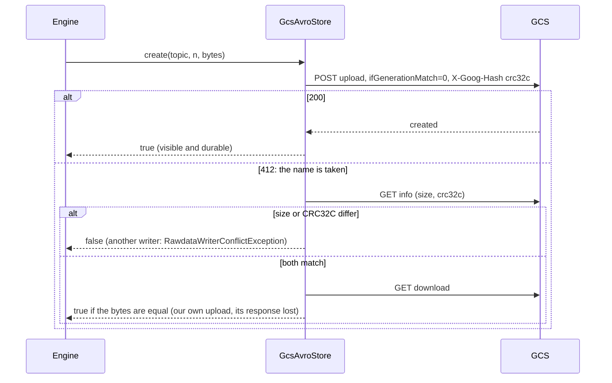

# rawdata-client-provider-gcs: the `gcs` provider

The `gcs` provider keeps topics as Avro files in a Google Cloud Storage bucket. It is the Avro engine of
[`rawdata-client-provider-avro`](rawdata-client-provider-avro.md) on a bucket: the same segments, layout, order and
upload window as [`filesystem`](rawdata-client-provider-filesystem.md) and [`s3`](rawdata-client-provider-s3.md).
Use it when your raw data should live in GCS, for example for an application that runs on Google Cloud.

It talks to GCS's JSON API with the JDK's own HTTP client (`java.net.http`) and does Google's OAuth 2.0 itself. It
needs no Google libraries: its only dependencies are the Avro engine and Jackson.

## Contents

- [Coordinates](#coordinates)
- [Quick start](#quick-start)
- [Concepts](#concepts)
- [How it works](#how-it-works)
- [Configuration](#configuration)
- [Credentials](#credentials)
- [Failure modes and troubleshooting](#failure-modes-and-troubleshooting)
- [Testing](#testing)
- [Reference](#reference)
- [See also](#see-also)

## Coordinates

| | |
|---|---|
| Maven | `io.descoped.rawdata:rawdata-client-provider-gcs`, version managed by `rawdata-client-bom` |
| JPMS module | `io.descoped.rawdata.provider.gcs` |
| Provider name | `gcs` (the value of `rawdata.client.provider`) |
| Depends on | `rawdata-client-provider-avro` (and through it the API and Apache Avro), `jackson-databind` |
| Exports | nothing: the provider is found by the service loader |

Import the BOM and add the provider as a runtime dependency. Your code depends on the API only:

```xml
<dependencyManagement>
    <dependencies>
        <dependency>
            <groupId>io.descoped.rawdata</groupId>
            <artifactId>rawdata-client-bom</artifactId>
            <version>3.0.1</version>
            <type>pom</type>
            <scope>import</scope>
        </dependency>
    </dependencies>
</dependencyManagement>

<dependencies>
    <dependency>
        <groupId>io.descoped.rawdata</groupId>
        <artifactId>rawdata-client-api</artifactId>
    </dependency>
    <dependency>
        <groupId>io.descoped.rawdata</groupId>
        <artifactId>rawdata-client-provider-gcs</artifactId>
        <scope>runtime</scope>
    </dependency>
</dependencies>
```

The module is a named module with `provides io.descoped.rawdata.api.RawdataClientInitializer`, and the jar also lists
the provider in `META-INF/services`. It works on the module path and on the class path. On the module path, an
application module needs only `requires io.descoped.rawdata.api;`.

## Quick start

You need a bucket, an account that may create, read, list and delete objects in it (for example the role
`roles/storage.objectUser`), and a local folder for the upload window. On a workstation, log in with gcloud first:

```sh
gcloud auth application-default login
```

Then write and read a topic:

```java
import io.descoped.rawdata.api.RawdataClient;
import io.descoped.rawdata.api.RawdataConsumer;
import io.descoped.rawdata.api.RawdataMessage;
import io.descoped.rawdata.api.RawdataProducer;

import java.nio.charset.StandardCharsets;
import java.time.Duration;
import java.util.List;
import java.util.Map;

Map<String, String> configuration = Map.of(
        RawdataClient.PROVIDER_KEY, "gcs",                     // "rawdata.client.provider"
        "gcs.bucket-name", "my-rawdata-bucket",
        "gcs.prefix", "rawdata/",                              // optional: a folder in the bucket
        "gcs.credential-provider", "application-default",      // gcloud login, a key file or the metadata server
        "local-temp-folder", "/var/lib/my-app/rawdata-buffer"); // where producers buffer before they upload

try (RawdataClient client = RawdataClient.create(configuration)) {
    try (RawdataProducer producer = client.producer("invoices")) {
        producer.publish(RawdataMessage.builder()
                .position("invoice-1001")
                .put("document", "<invoice/>".getBytes(StandardCharsets.UTF_8))
                .build());
    } // closing the producer uploads its window: the message is now in the bucket

    try (RawdataConsumer consumer = client.consumer("invoices")) {
        List<RawdataMessage> batch = consumer.receiveUpTo(100, Duration.ofSeconds(5));
        for (RawdataMessage message : batch) {
            System.out.println(message.id() + " " + message.position());
        }
    }
}
```

After this the bucket holds `rawdata/invoices/segments/0000000000000000000.avro`, an Avro file with the message.

On Google Cloud (GCE, GKE, Cloud Run) the same code works with `gcs.credential-provider=compute-engine`, or with
`application-default`, which finds the runtime's metadata server when nothing else is set. With a service account
key file, leave `gcs.credential-provider` out (the default is `service-account`) and set
`gcs.service-account.key-file`.

## Concepts

The provider adds GCS-specific concepts to those of the [API](rawdata-client-api.md) (topics, messages, UUIDv7
ids, consumers, metadata) and of the [Avro engine](rawdata-client-provider-avro.md) (segments, the upload window).
[Concepts](../concepts.md) explains the shared ones from the start.

### A topic is objects under a prefix

A topic is a set of objects whose names start with `<prefix><topic>/`:

```
gs://<bucket>/<prefix><topic>/segments/0000000000000000000.avro    segment 0
gs://<bucket>/<prefix><topic>/segments/0000000000000000001.avro    segment 1, and so on without gaps
gs://<bucket>/<prefix><topic>/metadata/k<hex of the key in UTF-8>  one object per metadata entry
```

- A **segment** is one Avro file with the messages of one upload window. Its number has 19 digits, so names sort
  in segment order. Segments are uploaded with content type `avro/binary`.
- A **metadata entry** is one object, named `k` and the key's UTF-8 bytes in lowercase hexadecimal, so any key,
  `/` and `..` included, is a safe object name. Its content type is `application/octet-stream`.
- The **prefix** (`gcs.prefix`) is a folder in the bucket. Several applications, or test runs, can share one bucket
  with a prefix each. A prefix without a trailing `/` gets one.

The topic name is validated by the API (1 to 100 of `A-Z a-z 0-9 _ . -`, starting with a letter or digit) before it
reaches the store, so it is never anything but a plain path segment.

### Generations and preconditions

GCS gives every version of an object a **generation**, a number that changes each time the object is written. A
request can carry a **precondition** on it: `ifGenerationMatch=0` means "only if there is no such object", and
`ifGenerationMatch=<n>` means "only if the object is still generation `n`". When the precondition fails, GCS
answers 412 and writes nothing.

The provider uses preconditions for every upload:

| Upload | Precondition | Why |
|---|---|---|
| a segment | `ifGenerationMatch=0` | only one writer ever creates segment `n`; a second writer finds it taken, which is how another writer is detected |
| a metadata entry | the generation it replaces, or `0` if there is none | a retry of a write that succeeded fails its precondition instead of writing twice |

This is why every request can be retried safely: a retried upload never overwrites what the first attempt wrote.

### Generation pinning

When a consumer opens a segment, the store reads the object's generation, size and CRC32C once, and reads every
range of the segment from that generation (`generation=<n>` on each download). A segment is large (up to
`avro-file.max.bytes`), so it is read in ranges: a seek reads only its header, `lastMessage` only its last block.
Pinning makes sure all those ranges come from the same object. The engine never replaces a segment, but if one is
replaced by hand, reads of the old generation fail with an `IOException` ("Generation … is gone") instead of
mixing the bytes of two objects.

### The CRC32C upload hash

Every upload, segment or metadata, carries an `X-Goog-Hash: crc32c=<base64>` header with the CRC32C of its bytes.
GCS computes the CRC32C of what it received and refuses the upload with 400 if the two differ, so bytes damaged on
the way are never stored. GCS also returns an object's CRC32C in its metadata, which the provider uses to recognise
its own segment after a lost response (below).

### One writer per topic, and the lost response

Only one process writes a topic ([concepts](../concepts.md)). In GCS, a second writer shows as a segment number that
is already taken: its `ifGenerationMatch=0` upload fails with 412, and the engine fails that writer with
`RawdataWriterConflictException`.

A 412 can also mean that this client's own upload succeeded but its response was lost, so the retry found the
object it had just created. The store tells the two apart:

1. It reads the object's size and CRC32C (one small metadata request).
2. If either differs from its own bytes, the segment is another writer's: `create` returns false, without
   downloading anything.
3. If both match, it downloads the object and compares it byte for byte. Equal bytes mean the segment is its own
   and counts as created. An Avro file carries a random sync marker, so another writer's file is never equal.

### Throttling report

GCS slows a client down with 429 (too many requests) and 503 (service unavailable). When a **segment upload** gets
one of these, or times out, on any attempt (also one that a retry then completes), the store tells the engine. The
engine halves how many uploads the client runs at once (AIMD, at most once a second) and grows it again by one per
successful round, up to `avro-file.upload.max-concurrency`. Reads, listings and metadata writes are not reported:
they say nothing about the bucket's upload capacity. See the [Avro engine](rawdata-client-provider-avro.md) for the
limiter.

### A missing bucket is not an empty topic

GCS answers 404 both for a missing object and for a missing bucket. The first time the store gets a 404 on a read,
it lists the bucket once (`maxResults=1` under the prefix). If the bucket does not exist, that listing fails, and
the client fails with `RawdataException` instead of reporting an empty topic. Once the bucket has been seen, the
store does not ask again.

## How it works

### The request path

```
RawdataClient (AvroRawdataClient, the engine)
   │  segments and metadata entries
   ▼
GcsAvroStore     object names, preconditions, the lost-response check, the bucket check
   │  upload, download, downloadRange, info, generation, list, checkBucket, delete
   ▼
GcsClient        GCS JSON API v1 on java.net.http: retries, backoff, 401 refresh, CRC32C header
   │  Authorization: Bearer <token>
   ▼
GcsCredentials   service account JWT, gcloud refresh token, metadata server, or none
```

The JSON API calls it makes:

| Call | Request |
|---|---|
| upload | `POST /upload/storage/v1/b/<bucket>/o?uploadType=media&name=<object>&ifGenerationMatch=<n>`, one request with the whole object |
| download | `GET /storage/v1/b/<bucket>/o/<object>?alt=media` |
| download a range | the same with `&generation=<n>` and a `Range: bytes=<from>-<to>` header; expects 206 |
| object info | `GET /storage/v1/b/<bucket>/o/<object>?fields=generation,size,crc32c` |
| list | `GET /storage/v1/b/<bucket>/o?prefix=<folder>&delimiter=/`, following `nextPageToken` |
| bucket check | `GET /storage/v1/b/<bucket>/o?prefix=<prefix>&maxResults=1` |
| delete | `DELETE /storage/v1/b/<bucket>/o/<object>`; a 404 counts as deleted |

Object names and query values are percent-encoded byte by byte, everything but the unreserved characters of RFC
3986, so `/` in an object name is sent as `%2F` as GCS requires.

### Publishing

A `publish` does not talk to GCS. It appends to the topic's upload window in `local-temp-folder`. When the window
closes (after `avro-file.max.seconds`, past `avro-file.max.bytes`, or when the producer closes), the engine uploads
it in the background as the topic's next segment:



- **Visibility and durability.** A message is visible to consumers, and durable in the bucket, once its segment
  upload returned. GCS shows an object whole or not at all, so a reader never sees half a segment.
- **Order.** A topic's segments are uploaded one at a time, in order, and each only after the last. Consumers
  therefore never see a gap, a duplicate or messages out of order.
- **Memory.** An upload holds its whole window in memory and sends it in one request: up to
  `avro-file.upload.max-concurrency` × `avro-file.max.bytes` of heap at once (1 GiB at the defaults).

### Reading

A consumer looks for the topic's next segment and opens it, [pinned to its generation](#generation-pinning). It
reads the segment in ranges. A consumer that is waiting for new messages looks again every
`gcs.listing.min-interval-seconds` seconds (1 by default); `0` looks as often as `receive` asks, but no more often
than every 10 ms. Each look is one request, so a low interval costs requests on a quiet topic.

### Metadata

- `put` reads the entry's current generation, then uploads with that generation as the precondition (or `0` when
  there is none). If another writer changed the entry in between (412), it reads the generation again and writes
  again: the last write wins. A reader sees the old value or the new, never a mix.
- `get` downloads the entry; a 404 is no entry (after the bucket check).
- `keys` lists `<prefix><topic>/metadata/` with `/` as delimiter, following every page.
- `remove` deletes the entry; a missing entry is fine.

GCS limits writes to one object name to about one per second. A metadata entry written more often gets 429, which
the client retries with backoff, so a tight loop of `put` on one key is slow rather than failing.

### Retries

Every request, reads, uploads, listings and deletes alike, is retried on an I/O error, a timeout, and on HTTP 408,
429 and 5xx:

| | Value |
|---|---|
| attempts | 6 in all |
| backoff | exponential from 200 ms, at most 5 s, with jitter (a random wait between half the ceiling and the ceiling) |
| connect timeout | 10 s |
| request timeout | 5 minutes per attempt |

Other statuses are not retried and fail with an `IOException` that carries GCS's own error message, for example
`Deleting … failed: HTTP 403 …`. The engine turns it into a `RawdataException`. Retrying is safe because reads and
deletes are idempotent and every upload has a [precondition](#generations-and-preconditions).

A 401 from GCS drops the kept token (it may have been revoked, or the clock may be off) and sends the request once
more, with a new token and its own retries. A second 401 fails.

None of these values are configurable.

## Configuration

Pass the keys to `RawdataClient.create(Map<String, String>)`. The provider's own keys:

| Key | Default | Meaning |
|---|---|---|
| `rawdata.client.provider` | | `gcs` |
| `gcs.bucket-name` | | required: the bucket |
| `gcs.prefix` | none | a folder in the bucket for the topics, for example `rawdata/`; a `/` is added if missing; must not start with `/`; at most 659 bytes in UTF-8 with the `/` |
| `gcs.credential-provider` | `service-account` | `service-account`, `compute-engine`, `application-default` or `none`; see [credentials](#credentials) |
| `gcs.service-account.key-file` | | the service account's JSON key file; required with `service-account` |
| `gcs.endpoint` | `https://storage.googleapis.com` | another API root, for example an emulator's `http://localhost:4443`; a trailing `/` is removed |
| `gcs.listing.min-interval-seconds` | `1` | how often a waiting consumer looks for new messages, in whole seconds; `0` as often as it asks (at least 10 ms apart) |

The Avro engine's upload window keys, the same in `filesystem`, `gcs` and `s3`; the
[Avro engine](rawdata-client-provider-avro.md) explains each:

| Key | Default | Meaning |
|---|---|---|
| `local-temp-folder` | | required: a local disk where producers buffer, one folder per topic; one process per folder |
| `avro-file.max.seconds` | `60` | the longest a window stays open |
| `avro-file.max.bytes` | `67108864` (64 MiB) | the size at which a window closes |
| `avro-file.sync.interval` | `524288` (512 KiB) | the size of an Avro block; each block is forced to disk |
| `avro-file.max.pending-uploads` | `4` | sealed windows that may wait for upload before `publish` waits |
| `avro-file.close-timeout-seconds` | `30` | the longest `close()` waits for the uploads |
| `avro-file.upload.max-concurrency` | `16` | the most uploads of a client at once, across its topics |

### How values are read

Values are read as [dynamic-configuration](https://github.com/descoped/dynamic-configuration) reads them, so an
application can pass `config.asMap()` or a `config.subset(..)`:

- **Enums** (`gcs.credential-provider`) are case-insensitive, trimmed, and read `-` as `_`: `compute-engine`,
  `COMPUTE_ENGINE` and `Compute_Engine` are the same. Any other value, blank included, fails with
  `IllegalArgumentException` that lists the allowed values.
- **Numbers** are strict: `60`, not `60s` and not ` 60`. A default covers a missing key, never a malformed value:
  `gcs.listing.min-interval-seconds=` (blank) is an error, not `1`.
- **Strings** are trimmed. A blank optional value (`gcs.prefix`, `gcs.endpoint`) is the default; a blank required
  value is missing.
- Every error names its key, for example `Missing configuration 'gcs.bucket-name'`.

### Name limits

GCS object names are at most 1024 bytes in UTF-8. With a prefix, the topic and `/metadata/k`, that limits a metadata
key to

```
(1024 − bytes of "<prefix><topic>/metadata/k") / 2
```

bytes in UTF-8, because the key is stored in hexadecimal. With no prefix and topic `invoices` that is 502 bytes. A
longer key is refused with `IllegalArgumentException` by `put`, `get` and `remove`.

The prefix is limited so that every topic (at most 100 characters) can always hold a key of 127 bytes, the length
every provider accepts (`RawdataMetadataClient.PORTABLE_KEY_BYTES`): 1024 − (100 + 11) − 2 × 127 = 659 bytes,
including the trailing `/`. A longer prefix fails when the client is created.

## Credentials

`gcs.credential-provider` chooses where tokens come from. Every token has the scope
`https://www.googleapis.com/auth/devstorage.read_write`.

| Value | Source | When it is read |
|---|---|---|
| `service-account` (default) | the JSON key in `gcs.service-account.key-file` | the file when the client is created; a token on the first request |
| `compute-engine` | the metadata server of a Google Cloud runtime (GCE, GKE, Cloud Run) | on the first request |
| `application-default` | Application Default Credentials, in Google's order (below) | when the client is created |
| `none` | no `Authorization` header | never; for an emulator |

The default is `service-account`, as in 2.x, so a configuration without `gcs.credential-provider` needs
`gcs.service-account.key-file`.

### Application Default Credentials

`application-default` takes the first of these that is there:

1. the file named by `GOOGLE_APPLICATION_CREDENTIALS`: a service account key, or a gcloud user's credentials;
2. gcloud's `application_default_credentials.json`, written by `gcloud auth application-default login`, in
   `$CLOUDSDK_CONFIG`, else `%APPDATA%\gcloud` on Windows, else `~/.config/gcloud`;
3. the metadata server of a Google Cloud runtime, if it answers within 2 seconds with `Metadata-Flavor: Google`.
   `GCE_METADATA_HOST` overrides its address (default `metadata.google.internal`), for both `application-default`
   and `compute-engine`.

If none is there, creating the client fails with `UncheckedIOException` ("Cannot load the application-default
credentials"), whose cause says what to do: set `GOOGLE_APPLICATION_CREDENTIALS`, run `gcloud auth
application-default login`, or run on Google Cloud.

### How a token is obtained

- **Service account key** (`"type": "service_account"`): a JWT with the key's `client_email` as issuer, the scope,
  and the key's `token_uri` as audience (default `https://oauth2.googleapis.com/token`), valid for an hour and
  signed with the key (RS256, the key's `private_key_id` as `kid`), is exchanged for an access token at `token_uri`.
  The private key must be RSA in PKCS#8 PEM, as Google issues it.
- **gcloud user** (`"type": "authorized_user"`): the refresh token, client id and client secret are exchanged for an
  access token at `token_uri`.
- **Metadata server**: `GET /computeMetadata/v1/instance/service-accounts/default/token` with
  `Metadata-Flavor: Google` gives a token for the runtime's service account.

A token is kept until five minutes before it expires, or for half its lifetime if that is shorter, and shared by all
requests of the client. A failed token request (an I/O error, a 5xx) is retried with the request that needed it. A
refusal from Google (a 4xx such as `invalid_grant`) fails at once and is not retried: retrying cannot help. No
credential's `toString` shows a secret.

### What is not supported

Workload identity federation (`"type": "external_account"`) and any other file type are refused with
`IllegalArgumentException` naming the type and the supported ones. On GKE, Workload Identity works through the
metadata server (`compute-engine` or `application-default`).

The account needs to create, read, list and delete objects in the bucket; `roles/storage.objectUser` covers that.
Overwriting a metadata entry replaces an object, which GCS counts as a delete too.

## Failure modes and troubleshooting

| Symptom | Cause and fix |
|---|---|
| `IllegalArgumentException: Provider 'gcs' is missing configuration: [gcs.bucket-name, local-temp-folder]` | a required key is missing (the list names the missing ones); add it |
| `IllegalArgumentException: Missing configuration 'gcs.bucket-name'` (or `local-temp-folder`) | a required key is blank; give it a value |
| `IllegalArgumentException` naming `gcs.service-account.key-file` | `gcs.credential-provider` is `service-account`, the default, and no key file is set; set it, or choose another credential provider |
| `UncheckedIOException: Cannot load the service-account credentials` | the key file cannot be read; check the path and permissions |
| `IllegalArgumentException: Credentials file … has type 'external_account'` | workload identity federation files are not supported; use a key, gcloud, or the metadata server |
| `IllegalArgumentException: … has no RSA private key in PKCS#8 PEM` | the key file is damaged or not a Google service account key |
| `UncheckedIOException: Cannot load the application-default credentials` | none of the three sources was found; see [Application Default Credentials](#application-default-credentials) |
| `IllegalArgumentException` naming `gcs.prefix` | the prefix starts with `/`, or is longer than 659 bytes |
| `RawdataException … Listing the bucket … failed: HTTP 404` (or `Uploading … failed: HTTP 404`) | the bucket does not exist, or the name is wrong |
| `RawdataException … HTTP 403 …` | the account may not do that in the bucket; grant `roles/storage.objectUser` or equivalent |
| `RawdataException … HTTP 401` | the token was refused twice; check the account, its key, and the machine's clock |
| `Getting an access token for … failed: HTTP 400 … invalid_grant` | Google refused the credentials: a revoked key or refresh token, or a clock far off; log in again or issue a new key |
| `RawdataWriterConflictException` | another process wrote the topic; only one process may write a topic. Stop one of them; a new client starts from the topic's end |
| "The writer of topic … failed" on `publish`, `flush` or `close` | an upload failed after six attempts, for example during an outage; the windows stay sealed in `local-temp-folder`, and the next client to write the topic uploads them in order |
| messages are not visible right after `publish` | they are visible once their window is uploaded: after `avro-file.max.seconds`, past `avro-file.max.bytes`, or when the producer closes |
| `IllegalArgumentException: The metadata key is too long for an object name in GCS` | the key, with the prefix and topic, does not fit in 1024 bytes; see [name limits](#name-limits) |
| `IOException: Generation … of … is gone` | a segment was replaced or deleted by hand while a consumer read it; segments are written once and must not be changed |
| uploads slow down under load | GCS is throttling (429, 503); the client lowers its concurrent uploads by itself. Large windows on a slow link may also time out (5 minutes per attempt), which counts as throttling; lower `avro-file.max.bytes` |

Things to keep in mind:

- **One process per buffer folder and per topic.** Give every process its own `local-temp-folder`.
- **Set `avro-file.close-timeout-seconds` below your platform's grace period** (Kubernetes'
  `terminationGracePeriodSeconds` defaults to 30, as does the close timeout), so `close()` returns before the
  process is killed. Windows not uploaded in time stay on disk for the next writer.
- **Size the heap for uploads**: `avro-file.upload.max-concurrency` × `avro-file.max.bytes`.
- **The bucket is checked once.** A bucket deleted while a client runs then reads as missing objects for that
  client.
- **Do not change objects under the prefix by hand.** The engine relies on segments numbered without gaps and never
  replaced.

## Testing

### How the module is tested

| Test | What it checks | Against |
|---|---|---|
| `GcsContractTest` | the provider contract (`AvroClientContractTest`, which extends `RawdataClientContractTest`), unchanged, with the metadata key limit and a missing bucket declared | `fsouza/fake-gcs-server` in Docker (Testcontainers) |
| `GcsStoreContractTest` | the Avro store contract (`AvroStoreContractTest`), and generation pinning | the fake GCS server |
| `GcsProviderTest` | the objects in the bucket and the configuration checks | the fake GCS server |
| `GcsClientTest` | retries, statuses, the CRC32C header, name encoding, paging, token retries and the 401 refresh | a local `jdk.httpserver` playing GCS |
| `GcsIntegrityTest` | the lost-response check by size and CRC32C, and timeouts reported as throttling | a local server, and an HTTP client that always times out |
| `GcsCredentialsTest` | the JWT, refresh tokens, the metadata server, token lifetimes, Application Default Credentials in Google's order, refused file types | a local server playing Google's token endpoint and the metadata server |

The tests run on the class path, because Testcontainers' dependencies are automatic modules with split packages; the
JPMS smoke test (`src/it/jpms/run.sh`) covers the module path against a fake GCS. They need Docker. Run them with:

```sh
./mvnw -pl rawdata-client-provider-gcs -am verify
```

A real bucket with real credentials is checked by hand before a release.

### Testing code that uses the provider

- **Unit tests**: code written against the API needs no GCS. Use the `memory` provider; every provider passes the
  same contract, so behaviour is the same.
- **Integration tests against an emulator**: run `fsouza/fake-gcs-server` and point the provider at it with
  `gcs.credential-provider=none` and `gcs.endpoint`. Create the bucket first; the emulator does not create it for
  you.

```java
GenericContainer<?> gcs = new GenericContainer<>("fsouza/fake-gcs-server:1.56.1")
        .withExposedPorts(4443)
        .withCommand("-scheme", "http", "-port", "4443", "-backend", "memory")
        .waitingFor(Wait.forHttp("/storage/v1/b").forPort(4443));
gcs.start();
String endpoint = "http://" + gcs.getHost() + ":" + gcs.getMappedPort(4443);
// create the bucket: POST {endpoint}/storage/v1/b?project=test with body {"name":"rawdata"}

Map<String, String> configuration = Map.of(
        RawdataClient.PROVIDER_KEY, "gcs",
        "gcs.bucket-name", "rawdata",
        "gcs.credential-provider", "none",
        "gcs.endpoint", endpoint,
        "gcs.listing.min-interval-seconds", "0",   // consumers look for new messages at once
        "local-temp-folder", Files.createTempDirectory("rawdata-buffer").toString(),
        "avro-file.max.seconds", "1");             // windows upload after a second
```

Messages become visible when their window is uploaded. In a test, close the producer before you read, or keep
`avro-file.max.seconds` low and let the consumer wait with `receive` or `receiveUpTo`.

- **Against a real bucket**: use `gcs.credential-provider=application-default` after `gcloud auth
  application-default login`, and a prefix per run so runs do not see each other's topics.

## Reference

The module exports no package. Its one public type is the provider, which the service loader finds; applications
use it through `RawdataClient.create`.

| Type | Visibility | Role |
|---|---|---|
| [`GcsRawdataClientInitializer`](../../rawdata-client-provider-gcs/src/main/java/io/descoped/rawdata/provider/gcs/GcsRawdataClientInitializer.java) | public, `@ProviderName("gcs")` | the provider: `Set<String> configurationKeys()` returns the required keys (`gcs.bucket-name`, `local-temp-folder`); `RawdataClient initialize(Map<String, String> configuration)` reads the configuration and returns an `AvroRawdataClient` on a `GcsAvroStore` |
| [`GcsAvroStore`](../../rawdata-client-provider-gcs/src/main/java/io/descoped/rawdata/provider/gcs/GcsAvroStore.java) | package-private | the `AvroStore` on a bucket: object names, preconditions, the lost-response check, generation pinning, the bucket check |
| [`GcsClient`](../../rawdata-client-provider-gcs/src/main/java/io/descoped/rawdata/provider/gcs/GcsClient.java) | package-private | the JSON API calls on `java.net.http`, with retries, backoff, the 401 refresh and the throttling report |
| [`GcsCredentials`](../../rawdata-client-provider-gcs/src/main/java/io/descoped/rawdata/provider/gcs/GcsCredentials.java) | package-private | tokens: `ServiceAccount`, `AuthorizedUser`, `MetadataServer`, and `NONE` |
| [`module-info.java`](../../rawdata-client-provider-gcs/src/main/java/module-info.java) | | requires `io.descoped.rawdata.provider.avro`, `java.net.http`, `com.fasterxml.jackson.databind`; provides `RawdataClientInitializer` |

Types from other modules that you meet with this provider: `RawdataClient`, `RawdataProducer`, `RawdataConsumer`,
`RawdataMetadataClient`, `RawdataException` and `RawdataWriterConflictException` in the
[API](rawdata-client-api.md); `AvroRawdataClient` (with `flush(String topic)`) and `AvroUploadWindow` in the
[Avro engine](rawdata-client-provider-avro.md).

## See also

- [Concepts](../concepts.md): topics, messages, ids, order, one writer per topic.
- [Tutorial](../tutorial.md): from nothing to a producer and a consumer.
- [rawdata-client-api](rawdata-client-api.md): the API every provider implements.
- [rawdata-client-provider-avro](rawdata-client-provider-avro.md): the engine, the upload window, closing and
  recovery after a crash.
- [rawdata-client-provider-filesystem](rawdata-client-provider-filesystem.md) and
  [rawdata-client-provider-s3](rawdata-client-provider-s3.md): the same engine on a folder and on S3.
- [rawdata-client-tck](rawdata-client-tck.md): the contract this provider passes.
- [rawdata-copy-util](rawdata-copy-util.md): copy topics to and from GCS.
