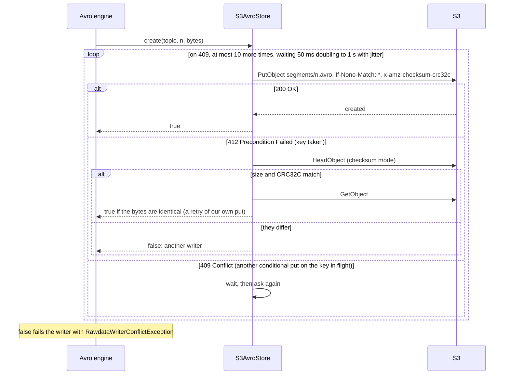

# rawdata-client-provider-s3

The `s3` provider keeps topics as Avro files in an Amazon S3 bucket. It is the Avro engine
([`rawdata-client-provider-avro`](rawdata-client-provider-avro.md)) on a bucket, through the AWS SDK for Java 2. Use
it when your raw data should live in S3, or in an S3-compatible store, and you want the SDK's usual credentials and
region handling.

| | |
|---|---|
| Maven | `io.descoped.rawdata:rawdata-client-provider-s3`, version managed by `rawdata-client-bom` |
| JPMS module | `io.descoped.rawdata.provider.s3` (exports nothing; found through the service loader) |
| Provider name | `s3` (the value of `rawdata.client.provider`) |
| Depends on | the Avro engine, the AWS SDK's `s3` and `url-connection-client`, and at run time `sts`, `sso` and `ssooidc` |

## Quick start

1. Import the BOM and add the provider:

   ```xml
   <dependencyManagement>
       <dependencies>
           <dependency>
               <groupId>io.descoped.rawdata</groupId>
               <artifactId>rawdata-client-bom</artifactId>
               <version>3.0.1</version>
               <type>pom</type>
               <scope>import</scope>
           </dependency>
       </dependencies>
   </dependencyManagement>

   <dependencies>
       <dependency>
           <groupId>io.descoped.rawdata</groupId>
           <artifactId>rawdata-client-provider-s3</artifactId>
       </dependency>
   </dependencies>
   ```

2. Make sure the AWS SDK can find credentials, for example `AWS_PROFILE=my-profile` (after `aws sso login` for an
   SSO profile), or run on AWS with a role.

3. Create a client, publish and read:

   ```java
   Map<String, String> configuration = Map.of(
           RawdataClient.PROVIDER_KEY, "s3",                    // "rawdata.client.provider"
           "s3.bucket-name", "my-rawdata-bucket",
           "s3.region", "eu-north-1",
           "s3.prefix", "rawdata/",
           "local-temp-folder", "/var/lib/my-app/rawdata-buffer");

   try (RawdataClient client = RawdataClient.create(configuration)) {
       try (RawdataProducer producer = client.producer("orders")) {
           producer.publish(RawdataMessage.builder()
                   .position("order-1")
                   .put("payload", "{\"amount\":42}".getBytes(StandardCharsets.UTF_8))
                   .build());
       } // closing the producer uploads its window to S3

       try (RawdataConsumer consumer = client.consumer("orders")) {
           RawdataMessage message = consumer.receive(5, TimeUnit.SECONDS); // null if none arrived in time
           System.out.println(message.position() + " " + message.id());
       }
   }
   ```

The bucket must exist; the provider never creates one. After the run the bucket holds
`rawdata/orders/segments/0000000000000000000.avro`.

## Concepts

The concepts every provider shares (topics, messages, ids, positions, cursors, metadata) are in
[concepts](../concepts.md). The Avro engine's concepts (segments, upload windows, recovery) are in
[the Avro engine](rawdata-client-provider-avro.md). This section covers what `s3` adds.

### A topic is objects under a prefix

A topic is a set of objects whose keys start with `<prefix><topic>/`:

```
s3://<bucket>/<prefix><topic>/segments/0000000000000000000.avro    segment 0, content type avro/binary
s3://<bucket>/<prefix><topic>/segments/0000000000000000001.avro    segment 1
s3://<bucket>/<prefix><topic>/metadata/k<hex of the key>           one metadata entry, application/octet-stream
```

- A **segment** is one Avro file: the messages of one upload window. Segments are numbered 0, 1, 2 and so on, in 19
  digits, so the keys sort in segment order. There are never gaps.
- A **metadata entry** is one object. Its name is `k` followed by the key's UTF-8 bytes in lowercase hexadecimal, so
  any key is a safe object name. The entry `checkpoint` is the object `metadata/k636865636b706f696e74`.
- The **prefix** (`s3.prefix`) is a folder for all topics, so one bucket can hold several applications' data. It must
  not start with `/`; a `/` is added at the end if missing (`folder` becomes `folder/`).

The layout is the same as in `gcs`, so the [copy tool](rawdata-copy-util.md) and the engine treat both alike.

### The conditional put: how one writer is guaranteed

A segment is uploaded in one `PutObject` with the header `If-None-Match: *`. S3 then creates the object only if no
object has that key. This is the property the Avro engine needs from a store: a segment is created once, whole, and
readers see all of it or none of it.

It is also how another writer is detected. Only one process may write a topic (see
[one writer per topic](../contract.md#one-writer-per-topic)). The writer uploads the segment after the last one it
knows. If that key is taken by someone else's bytes, another process wrote the topic, and the publish fails with
`RawdataWriterConflictException`.

### Telling a lost response from another writer

The SDK retries a put whose response did not arrive. If the first attempt did succeed, the retry finds its own
object and S3 answers 412 Precondition Failed. The store must not mistake that for another writer, so it checks what
the key holds:

1. a `HeadObject` with checksum mode on gives the object's size and CRC32C;
2. if either differs from the bytes the store tried to put, it is another writer's segment (one HEAD, no download);
3. if both match, the store downloads the object and compares it byte for byte.

Only identical bytes count as "created". No other writer's file can be identical, because every Avro file carries a
random 16-byte sync marker.

### Integrity: CRC32C on every segment

Every segment put carries its CRC32C in `x-amz-checksum-crc32c`. S3 computes its own checksum of what it received
and refuses the put if they differ, so bytes damaged on the way are never stored. The SDK then retries.

### Reads are pinned to one object version: ETag pinning

A segment can be up to `avro-file.max.bytes` (64 MiB by default), so consumers read it in byte ranges. When the
engine opens a segment, the store sends one `HeadObject` and remembers the object's size and ETag. Every range is
then a `GetObject` with `Range: bytes=a-b` and `If-Match: <ETag>`.

The engine never replaces a segment, so in normal use the ETag never changes. If someone replaces or deletes the
object by hand while it is open, the next range fails with `IOException` ("is no longer the object that was opened")
instead of returning bytes from two different files.

### Throttling feedback

S3 answers an overloaded prefix with 503 `SlowDown`. The SDK retries such responses by itself, but the engine also
needs to know, so it can run fewer uploads at once. `S3Throttling` is an SDK execution interceptor that sees every
attempt and tells the engine when a **segment put** (a `PutObject` with `If-None-Match: *`):

- got a 503 or a 429, or
- timed out (an API call or attempt timeout, or a socket timeout).

Reads and metadata writes are not reported: they say nothing about the bucket's upload capacity. The engine halves
its upload concurrency on a report, at most once a second, and grows it again after uploads succeed (AIMD, see
[the Avro engine](rawdata-client-provider-avro.md)).

### A missing bucket is an error, never an empty topic

S3 answers a `HeadObject` for a missing object and for a missing bucket with the same bodyless 404. A wrong bucket
name could therefore look like an empty topic. The first time the store sees a 404 on a HEAD, it lists the prefix
once (`ListObjectsV2`, one key). For a missing bucket S3 answers `NoSuchBucket`, and the call fails. Once the bucket
has been seen, the store does not check again. A `GetObject` tells the two apart by itself (`NoSuchKey` reads as
missing, `NoSuchBucket` fails).

This is the contract's rule: a store that does not exist fails with `RawdataException`, it never reads as empty.

### Metadata entries are plain puts

A metadata write is an ordinary `PutObject`, which S3 applies atomically. The last write wins, and a retry is
harmless. A remove is a `DeleteObject`.

### The HTTP client: JDK only

The provider builds its `S3Client` on the SDK's `url-connection-client`, which runs on the JDK's
`HttpURLConnection`. The SDK's other HTTP clients (Apache, Apache 5, Netty, the CRT) are excluded from the
dependencies and banned by the Maven Enforcer, so they never reach your application through this module. The client
uses a 10-second connection timeout and a 5-minute socket timeout, and the SDK's standard retry strategy with six
attempts per request (throttling, 5xx and I/O errors, with backoff).

### Credentials and region come from the SDK

With the default `s3.credentials=default`, the provider uses the SDK's `DefaultCredentialsProvider`, which looks in
order at:

1. environment variables (`AWS_ACCESS_KEY_ID`, `AWS_SECRET_ACCESS_KEY`, `AWS_SESSION_TOKEN`);
2. Java system properties (`aws.accessKeyId`, `aws.secretAccessKey`, `aws.sessionToken`);
3. web identity (EKS IRSA or another OIDC provider: `AWS_WEB_IDENTITY_TOKEN_FILE` and `AWS_ROLE_ARN`);
4. the profile in `AWS_PROFILE` (or `default`) in `~/.aws/credentials` and `~/.aws/config`, including SSO and role
   profiles;
5. container credentials (ECS, EKS Pod Identity);
6. the EC2 instance metadata service.

The STS, SSO and SSO OIDC modules come with the provider at run time, so web identity and SSO profiles work without
adding anything. Credentials are resolved on the first request, not when the client is created.

Without `s3.region`, the SDK's region chain decides: `AWS_REGION`, the profile's `region`, then the instance metadata.
The region is resolved when the client is created, so a missing region fails `RawdataClient.create`.

Other kinds: `profile` (a named profile, `s3.profile`), `static` (`s3.access-key-id` and `s3.secret-access-key`, for
an emulator or a store with fixed keys) and `anonymous` (unsigned requests, for a public bucket or an emulator). The
credentials provider is closed with the client.

### Bucket names with dots: path style

S3 has two URL styles:

- virtual-hosted: `https://my-bucket.s3.eu-north-1.amazonaws.com/key`, the default;
- path style: `https://s3.eu-north-1.amazonaws.com/my-bucket/key`.

AWS's TLS certificate covers one name level below `s3.<region>.amazonaws.com`, so a virtual-hosted request to
`my.bucket` fails the TLS check. The provider therefore uses path style for a bucket name with a dot and
virtual-hosted otherwise, unless `s3.path-style-access` says otherwise. S3-compatible stores and emulators often need
`s3.path-style-access=true`.

### Server-side encryption

S3 encrypts every object at rest with the bucket's default encryption. Set `s3.sse` to ask for a specific kind on
every put, segment and metadata alike:

- `AES256`: S3-managed keys (SSE-S3);
- `aws:kms`: AWS KMS (SSE-KMS), with the account's default key, or the key in `s3.sse-kms-key-id` (a key id, ARN or
  `alias/...`).

`s3.sse-kms-key-id` without `s3.sse=aws:kms` is refused. Reads need nothing extra: S3 decrypts for any caller allowed
to use the key.

## How it works

The engine does the buffering, ordering and recovery; the store does the S3 calls. A publish appends to the topic's
open window on local disk. When the window closes (by age, size or a producer's close), the engine seals it and uploads
it in the background as the topic's next segment. **A message is visible to consumers, and durable in S3, once its
window is uploaded**, not when `publish` returns. Details of the window are in
[the Avro engine](rawdata-client-provider-avro.md).

### Uploading a segment



- **200**: the segment exists, whole. Consumers can see it from now on.
- **412**: the key was taken. Either our own earlier attempt (counts as created) or another process (the engine
  fails the topic's writer with `RawdataWriterConflictException`).
- **409** (`ConditionalRequestConflict`): two conditional puts on the same key were in flight at once. The store waits
  a random time between half and all of 50 ms, 100 ms, 200 ms and so on, capped at 1 s, and puts again to learn who
  won. After the first put and ten more it gives up with `IOException`.
- Anything else, after the SDK's six attempts, is an `IOException`, which the engine turns into a failed writer
  (`RawdataException`); the sealed window stays on disk and the next writer uploads it.

The engine runs a topic's uploads one at a time, in segment order, so segments are never created out of order.

### Reading

- `exists(topic, n)` and `open(topic, n)` are a `HeadObject` on the segment key. `open` keeps the size and ETag.
- Ranges of an opened segment are `GetObject` with `Range` and `If-Match`.
- A consumer that has read everything waits and looks for the next segment at most every
  `s3.listing.min-interval-seconds` seconds (default 1). Each look is a HEAD on the next segment's key, so a waiting
  consumer costs about one request a second.
- Metadata keys are a `ListObjectsV2` of `<prefix><topic>/metadata/` (paginated); values are `GetObject`.

### Requests and permissions

| Operation | S3 request | IAM permission |
|---|---|---|
| upload a segment | `PutObject` with `If-None-Match: *` | `s3:PutObject` |
| check a taken key | `HeadObject`, then maybe `GetObject` | `s3:GetObject` |
| find, open, read a segment | `HeadObject`, ranged `GetObject` with `If-Match` | `s3:GetObject` |
| check the bucket after a 404 | `ListObjectsV2` of the prefix, one key | `s3:ListBucket` |
| list metadata keys | `ListObjectsV2` of the topic's `metadata/` | `s3:ListBucket` |
| read, write, remove metadata | `GetObject`, `PutObject`, `DeleteObject` | `s3:GetObject`, `s3:PutObject`, `s3:DeleteObject` |

With a customer-managed KMS key the role also needs `kms:Encrypt`, `kms:Decrypt` and `kms:GenerateDataKey` on it.

## Configuration

Keys are passed in the map given to `RawdataClient.create`. String values are trimmed; a blank value counts as
missing.

| Key | Default | Meaning |
|---|---|---|
| `rawdata.client.provider` | | `s3` |
| `s3.bucket-name` | | Required. The bucket; it must exist. |
| `s3.prefix` | none | A folder in the bucket for the topics, for example `rawdata/`. Must not start with `/`; `/` is added at the end. At most 659 bytes in UTF-8 with that `/`. |
| `s3.region` | the SDK's region chain | The bucket's region, for example `eu-north-1`. |
| `s3.credentials` | `default` | `default`, `profile`, `static` or `anonymous` (exact, lowercase). |
| `s3.profile` | | Required for `profile`: the profile in `~/.aws/config` and `~/.aws/credentials`. |
| `s3.access-key-id` | | Required for `static`. |
| `s3.secret-access-key` | | Required for `static`. |
| `s3.endpoint` | AWS's | Another endpoint URI, for an S3-compatible store or an emulator, for example `http://localhost:9090`. |
| `s3.path-style-access` | `true` if the bucket name has a dot, else `false` | `true` or `false` (exact): path-style requests. |
| `s3.sse` | the bucket's default encryption | `AES256` or `aws:kms` (exact), asked for on every put. |
| `s3.sse-kms-key-id` | the account's default KMS key | The KMS key for `aws:kms`; refused with any other `s3.sse`. |
| `s3.listing.min-interval-seconds` | `1` | How often a waiting consumer looks for new segments, in whole seconds; `0` looks as often as a receive asks (but at most every 10 ms). |
| `local-temp-folder` | | Required. Where producers buffer windows: a local disk, one folder per process. |
| `avro-file.max.seconds` | `60` | The longest a window stays open. |
| `avro-file.max.bytes` | `67108864` (64 MiB) | The size at which a window closes. |
| `avro-file.sync.interval` | `524288` (512 KiB) | The size of an Avro block; a crash loses at most the block being written. |
| `avro-file.max.pending-uploads` | `4` | Sealed windows of a topic that may wait for upload before `publish` waits. |
| `avro-file.close-timeout-seconds` | `30` | The longest `close()` waits for the uploads. |
| `avro-file.upload.max-concurrency` | `16` | The most uploads of a client at once, across its topics. |

Numbers are strict: `60`, not `60s`. A default covers a missing key, never a malformed value, and every error is an
`IllegalArgumentException` that names the key. The window keys are explained in
[the Avro engine](rawdata-client-provider-avro.md).

### Limits

- **Object keys** are at most 1024 bytes in S3. A metadata entry's object key is
  `<prefix><topic>/metadata/k` plus twice the key's UTF-8 length, so a metadata key may be at most
  (1024 − bytes of `<prefix><topic>/metadata/k`) / 2 bytes: 506 with no prefix and a one-letter topic, 456 with no
  prefix and a 100-character topic. A longer key is refused with `IllegalArgumentException`.
- **The prefix** is at most 659 bytes, so that a metadata key of 127 bytes (`RawdataMetadataClient.PORTABLE_KEY_BYTES`,
  the length every provider accepts) always fits, even with a 100-character topic.
- **Memory**: each running upload holds its window in memory, so uploads can take up to
  `avro-file.upload.max-concurrency` × `avro-file.max.bytes` of heap, 1 GiB at the defaults.

### Examples

An S3-compatible store or an emulator:

```java
Map<String, String> configuration = Map.of(
        "rawdata.client.provider", "s3",
        "s3.bucket-name", "rawdata",
        "s3.region", "us-east-1",
        "s3.endpoint", "http://localhost:9090",
        "s3.path-style-access", "true",
        "s3.credentials", "static",
        "s3.access-key-id", "test",
        "s3.secret-access-key", "test",
        "local-temp-folder", "/tmp/rawdata-buffer");
```

Encryption with a customer-managed KMS key:

```java
configuration.put("s3.sse", "aws:kms");
configuration.put("s3.sse-kms-key-id", "alias/rawdata");
```

## Failure modes and troubleshooting

| Symptom | Cause | What to do |
|---|---|---|
| `IllegalArgumentException: Provider 's3' is missing configuration: [s3.bucket-name, local-temp-folder]` | a required key is missing (the list names the missing ones) | set it |
| `IllegalArgumentException: Missing configuration 's3.bucket-name'` (or `local-temp-folder`, `s3.profile`, `s3.access-key-id`, `s3.secret-access-key`) | a required key is blank, or a key the chosen `s3.credentials` needs is missing | set it |
| `IllegalArgumentException` naming `s3.credentials`, `s3.path-style-access` or `s3.sse` | a value outside the allowed set; they are case-sensitive | use exactly the values in the table |
| `Unable to load region` from `RawdataClient.create` | no `s3.region`, and the SDK's region chain found nothing | set `s3.region` or `AWS_REGION` |
| `Unable to load credentials from any of the providers in the chain` on the first call | the default chain found nothing | set `AWS_PROFILE` (and `aws sso login`), the `AWS_*` variables, or use a role |
| a `RawdataException` whose cause is `NoSuchBucket` | the bucket name is wrong, or the bucket is in another account | fix `s3.bucket-name`; the provider never creates a bucket |
| `AccessDenied` | the role lacks a permission in the table above, or the KMS key's | grant it |
| a TLS error with a bucket name with dots | `s3.path-style-access=false` forces virtual-hosted HTTPS | leave the key out |
| `RawdataWriterConflictException` on publish | another process wrote the topic since this client last wrote it | stop the other writer; a new client starts from the topic's end |
| a `RawdataException` on publish, flush or close after uploads failed | S3 failed a segment put after six attempts (or ten 409s) | fix the cause and start a new client: the sealed windows stay on disk and its writer uploads them |
| a read fails with "is no longer the object that was opened" | a segment object was replaced or deleted by hand | do not change segment objects; the engine never does |
| messages are not visible right after `publish` | they become visible when their window is uploaded | close the producer, wait up to `avro-file.max.seconds`, or lower it |
| `IllegalArgumentException` on a metadata key | the key is too long for a 1024-byte object key | use a shorter key or prefix |
| uploads slow down under load | S3 throttles (503 `SlowDown`) and the engine lowers its concurrency | expected; spread topics or raise S3's capacity for the prefix |

A failed S3 call reaches the application as a `RawdataException` (unchecked) whose cause is the store's
`IOException`; that in turn wraps the SDK's exception, so the S3 error code is in the cause chain.

## Testing

### How the module is tested

All tests are JUnit 6 and run on the class path (Testcontainers' dependencies are automatic modules with split
packages); the JPMS smoke test (`src/it/jpms/run.sh`) covers the module path against S3Mock.

| Test | What it checks |
|---|---|
| `S3ContractTest` | the provider contract (`RawdataClientContractTest`, through `AvroClientContractTest`) against [S3Mock](https://github.com/adobe/S3Mock) (`adobe/s3mock`) in Docker, with the metadata key limit declared to the TCK |
| `S3StoreContractTest` | the Avro store contract (`AvroStoreContractTest`) for `S3AvroStore`, including a missing bucket |
| `S3ProviderTest` | the object layout and content types, `AES256` on every put, configuration checks, every credential kind |
| `S3AvroStoreTest` | failures as `IOException` (`NoSuchBucket`, unreachable endpoint), the KMS key on the put, 409 retries (a stub, as S3Mock never answers 409), ETag pinning, the size and CRC32C check before a download, throttling reports |
| `S3LiveContractTest` | the same contract against real S3, only on request |

Run them (needs Docker):

```sh
./mvnw verify -pl rawdata-client-provider-s3 -am
```

The **live tests** run only with `-Drawdata.s3.live=true`, with credentials from the SDK's default chain. CI never
runs them.

```sh
AWS_PROFILE=<profile> ./mvnw verify -pl rawdata-client-provider-s3 -am -Drawdata.s3.live=true
```

The bucket and region default to `descoped-rawdata-test` in `eu-north-1`; change them with
`-Drawdata.s3.live.bucket` and `-Drawdata.s3.live.region`. A run writes under `rawdata-client-test/<random>/` and
removes it afterwards.

S3Mock does not apply `If-None-Match` atomically when two puts race. That does not matter for one writer per topic,
and the contract's second-writer test is sequential.

### Testing your own code

- **Unit tests**: most code that uses the client does not care which provider runs. Use the `memory` provider
  (`rawdata.client.provider=memory`, in `rawdata-client-api`), which needs no Docker and no AWS. Since every
  provider passes the same TCK, behaviour carries over.
- **Integration tests against S3**: run S3Mock in Docker (for example with Testcontainers' `GenericContainer` on
  `adobe/s3mock`, port 9090), create the bucket, and use the emulator configuration above with
  `s3.endpoint` set to the container's address. Set `avro-file.max.seconds` low (the module's tests use `1`) and
  `s3.listing.min-interval-seconds` to `0`, so messages show up quickly.
- **Waiting for a publish**: close the producer, which uploads its window, or call
  `((AvroRawdataClient) client).flush(topic)`, which uploads the topic's windows and waits, without closing anything.
  `AvroRawdataClient` is in `io.descoped.rawdata.provider.avro`; on the module path your test module must
  `requires io.descoped.rawdata.provider.avro` for the cast.
- Give each client its own `local-temp-folder`: a writer holds a lock in its topic's folder, and a second client on
  the same folder fails with "in use".

## Reference

The module exports no package. The application uses the API (`RawdataClient` and friends); the provider is found by
name through `RawdataClientInitializer`, registered with `provides` in `module-info.java` and in
`META-INF/services`, so it works on the module path and the class path.

| Type | Role |
|---|---|
| [`S3RawdataClientInitializer`](../../rawdata-client-provider-s3/src/main/java/io/descoped/rawdata/provider/s3/S3RawdataClientInitializer.java) | public, `@ProviderName("s3")`. `Set<String> configurationKeys()` returns the required keys (`s3.bucket-name`, `local-temp-folder`); `RawdataClient initialize(Map<String, String> configuration)` checks the configuration, builds the `S3Client` and returns an `AvroRawdataClient` on an `S3AvroStore`. |
| [`S3AvroStore`](../../rawdata-client-provider-s3/src/main/java/io/descoped/rawdata/provider/s3/S3AvroStore.java) | package-private `AvroStore`: `create` (the conditional put), `open` (ETag-pinned ranges), `exists`, `metadataNames`, `readMetadata`, `writeMetadata`, `deleteMetadata`, `onThrottled`, `close` (closes the `S3Client` and the credentials provider). |
| [`S3Throttling`](../../rawdata-client-provider-s3/src/main/java/io/descoped/rawdata/provider/s3/S3Throttling.java) | package-private SDK `ExecutionInterceptor` that reports throttled or timed-out segment puts to the engine. |
| [`module-info.java`](../../rawdata-client-provider-s3/src/main/java/module-info.java) | requires the Avro engine and the SDK modules; `provides RawdataClientInitializer`. The name ends in a digit, as the SDK's `software.amazon.awssdk.services.s3` does, so the module warning is suppressed. |
| [`pom.xml`](../../rawdata-client-provider-s3/pom.xml) | the SDK dependencies, the excluded and banned HTTP clients, `-Xlint:all,-requires-automatic` (the SDK's jars are automatic modules). |

The SDK's jars are automatic modules with stable `Automatic-Module-Name`s, so an application can put the provider
on the module path or the class path.

## See also

- [Concepts](../concepts.md): topics, messages, ids, cursors and metadata.
- [Tutorial](../tutorial.md): from nothing to a running client.
- [The Avro engine](rawdata-client-provider-avro.md): segments, upload windows, recovery, throttling.
- [The `gcs` provider](rawdata-client-provider-gcs.md) and
  [the `filesystem` provider](rawdata-client-provider-filesystem.md): the same engine on other stores.
- [The API](rawdata-client-api.md) and [the TCK](rawdata-client-tck.md).
- [The copy tool](rawdata-copy-util.md): copy topics between S3 and other providers.
- [The contract](../contract.md): what every provider guarantees.
