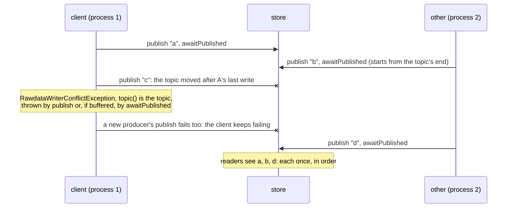

# rawdata-client-tck

The TCK (technology compatibility kit) is the provider contract written as abstract JUnit 6 tests. A provider's test
class extends one of them and says how to configure a client; JUnit then runs every inherited test against that
provider. You need this module when you write a provider, change one, or change the contract itself. Applications
that only use the rawdata client do not need it.

The module holds three contracts:

| Class | Package | Checks | Extended by |
|---|---|---|---|
| `RawdataClientContractTest` | `io.descoped.rawdata.tck` | everything an application can see through `RawdataClient` | every provider |
| `AvroClientContractTest` | `io.descoped.rawdata.tck.avro` | the client contract, plus the Avro engine's upload window | `filesystem`, `gcs`, `s3` |
| `AvroStoreContractTest` | `io.descoped.rawdata.tck.avro` | an `AvroStore`, the storage layer under the Avro engine | the stores of `filesystem`, `gcs`, `s3` |

This page explains what the TCK checks and how it runs. The step-by-step guide to building a provider, including
the provider service and `AvroStore`, is [Writing a provider](../writing-a-provider.md).

## Coordinates

| | |
|---|---|
| groupId | `io.descoped.rawdata` |
| artifactId | `rawdata-client-tck` |
| version | managed by `rawdata-client-bom` (3.0.0 and later) |
| JPMS module | `io.descoped.rawdata.tck` (an `open` module) |
| Scope | `test`: it is a test library |

```xml
<dependency>
    <groupId>io.descoped.rawdata</groupId>
    <artifactId>rawdata-client-tck</artifactId>
    <scope>test</scope>
</dependency>
<!-- The TCK brings the JUnit API; the engine that runs the tests is yours to add. -->
<dependency>
    <groupId>org.junit.jupiter</groupId>
    <artifactId>junit-jupiter</artifactId>
    <scope>test</scope>
</dependency>
```

Inside this repository the providers declare the TCK with `${project.version}` and the JUnit version from the
`junit.version` property of the root POM.

The module `requires transitive` `io.descoped.rawdata.api`, `io.descoped.rawdata.provider.avro`,
`org.junit.jupiter.api` and `org.junit.jupiter.params`, and exports `io.descoped.rawdata.tck` and
`io.descoped.rawdata.tck.avro`. It depends on the Avro engine for every provider, `postgres` included, because the
Avro contracts live in the same jar. The JUnit engine (`junit-jupiter-engine`) is only a test dependency of the TCK,
so it does not reach you through it.

## Quick start

The smallest compliant test is the one this module runs on itself, against the built-in `memory` provider
([`MemoryContractTest`](../../rawdata-client-tck/src/test/java/io/descoped/rawdata/tck/test/MemoryContractTest.java)):

```java
import io.descoped.rawdata.api.RawdataClient;
import io.descoped.rawdata.tck.RawdataClientContractTest;

import java.util.Map;

class MemoryContractTest extends RawdataClientContractTest {

    @Override
    protected Map<String, String> configuration() {
        return Map.of(RawdataClient.PROVIDER_KEY, "memory");
    }

    // A memory client keeps its own topics, so there is no second client on the same store.
    @Override
    protected boolean clientsShareTheStore() {
        return false;
    }
}
```

For a provider of your own:

1. Add `rawdata-client-tck` and `junit-jupiter` as test dependencies.
2. Create a test class that extends `RawdataClientContractTest` (or `AvroClientContractTest` for a provider on the
   Avro engine).
3. Implement `configuration()`: return the keys that create a client of your provider on a test store, including
   `rawdata.client.provider` (`RawdataClient.PROVIDER_KEY`).
4. Override the other hooks your provider needs: its metadata key limit, a store that does not exist, and so on
   (see [Hooks](#hooks)).
5. Run `./mvnw verify`. Every inherited test must pass, unchanged.

A typical store-backed provider looks like the postgres one
([`PostgresContractTest`](../../rawdata-client-provider-postgres/src/test/java/io/descoped/rawdata/provider/postgres/test/PostgresContractTest.java)):

```java
class PostgresContractTest extends RawdataClientContractTest {

    @Override
    protected Map<String, String> configuration() {
        return Postgres18.configuration();
    }

    // Below what a PostgreSQL btree index entry holds.
    @Override
    protected OptionalInt metadataKeyLimit(String topic) {
        return OptionalInt.of(2000);
    }

    @Override
    protected Map<String, String> missingStoreConfiguration() {
        Map<String, String> configuration = Postgres18.configuration();
        configuration.put("postgres.driver.database", "no_such_database");
        return configuration;
    }
}
```

## Concepts

### Compliance means passing unchanged

A provider is compliant when it passes the TCK without skipping, overriding or editing a test. That is the point of
the module: everything an application can see through the API behaves the same in every provider, so an application
can swap one provider for another, or move its data with the [copy tool](rawdata-copy-util.md), without changing
code. A provider that needs a test changed is a provider that behaves differently, and the difference belongs in the
contract (for every provider) or nowhere.

The hooks are the only things a provider may supply. They describe the provider (how to configure it, which limits
its store has); they never relax a behaviour.

### Behaviour tests and internal tests

A test of behaviour an application can see goes in the TCK, never in one provider's tests. A provider's own tests
check only what the API cannot show: the SQL it runs, the files or objects it writes, its configuration and its
credentials. If you find a behaviour worth testing in one provider, add it to the TCK so that every provider keeps
it. This is how the contract grows.

### A fresh client and a fresh topic per test

Before each test, `RawdataClientContractTest` calls `configuration()`, creates a client with
`RawdataClient.create(configuration())`, and picks a topic named `tck-` followed by a random UUID. After each test it
closes the client. The protected fields `client` and `topic` hold them.

Because the topic is new for every test, tests never see each other's messages, even when the store keeps data
between tests. The store may therefore be shared by the whole test class (one database, one folder, one bucket), and
nothing needs to be cleaned up between tests. `AvroStoreContractTest` does the same with a new store and a topic
named `store-` followed by a UUID.

Every test class has `@Timeout(60)`: a test that hangs, for example a `receive` that is never woken, fails after 60
seconds instead of blocking the build.

### One call of `configuration()` is one process

Only one process writes a topic (see [One writer per topic](../contract.md#one-writer-per-topic)). To check what
happens when a second process writes anyway, the TCK creates a second client from a second call of
`configuration()`. Each call therefore stands for another process on the same store:

- It must reach **the same store** as the first call: the same database, folder or bucket.
- It must have **its own local state**. A provider on the Avro engine buffers on a local disk, and each process has
  its own disk, so each call returns a new `local-temp-folder`. The filesystem test appends a random UUID to the
  folder name; the gcs and s3 tests create a temporary directory per call.

### Clients that share the store

`clientsShareTheStore()` says whether two clients made from `configuration()` see the same data. It is true for
every provider that keeps data outside the client. It is false only for `memory`, whose topics live in the client
and are gone when it closes. Where it is false, the three tests that need a second client on the same store are
skipped with a JUnit assumption: a second writer, a writer that restarts, and a consumer in another client.

### Declared limits

Stores have different limits, and the TCK lets a provider declare them instead of failing on them. The only one
today is the length of a metadata key:

- `metadataKeyLimit(topic)` returns the longest key, in UTF-8 bytes, that the provider's documentation states. It
  takes the topic because in some stores the limit depends on the topic's name (an object name in GCS or S3 holds
  the prefix, the topic and the key).
- Every provider must take at least `RawdataMetadataClient.PORTABLE_KEY_BYTES` (127 bytes). A key that short works
  everywhere; the TCK fails a provider that declares less.
- A provider with no limit returns `OptionalInt.empty()`, and the TCK checks that a 10,000-byte key works.

What the providers in this repository declare:

| Provider | `metadataKeyLimit` |
|---|---|
| `memory` | none |
| `postgres` | 2000 |
| `filesystem` | 127 (a file name is at most 255 characters: `k` and the key in hex) |
| `gcs`, `s3` | `(1024 - bytes of prefix + topic + "/metadata/k") / 2` |

The declared limit must also be in the provider's documentation, so applications can see it.

### A store that does not exist

A store that does not exist (a missing database, bucket or folder) must fail with `RawdataException`, either when the
client is created or on first use. It must never read as an empty topic: an application that reads a misspelt bucket
as empty would copy or process nothing and report success. `missingStoreConfiguration()` gives the TCK such a store;
a provider that has nothing that can be missing returns null, and the test is skipped.

Finding a store that cannot exist takes some care. The filesystem provider creates a missing folder, so its test
points the storage folder inside a regular file. The postgres test names a database that does not exist, and gcs and
s3 name a bucket that does not exist.

### Visibility: `awaitPublished`

Providers differ in when a published message becomes visible to consumers. In `postgres` and `memory`, it is visible
when `publish` returns. The Avro engine buffers messages in an upload window and makes them visible when the window is
uploaded (see [the upload window](rawdata-client-provider-avro.md#upload-window)).

`awaitPublished(client, topic)` is the TCK's barrier: it waits until what `client` has published to `topic` is
visible and durable. The default does nothing. `AvroClientContractTest` implements it with
`AvroRawdataClient.flush(topic)`, which closes the topic's open window and waits for its upload. A failure of a
buffered publish, such as `RawdataWriterConflictException`, is thrown from `awaitPublished`.

Most tests do not need the barrier, because they close the producer before they read: closing a producer makes what
it published visible and durable, in every provider. `awaitPublished` is used where the producer stays open, and in
the tests with a second writer, where the conflict of a buffering provider may show only on upload.

### The store contract

`AvroStoreContractTest` checks an `AvroStore` directly, below the client. The Avro engine relies on a few properties
of its store, and a store that breaks one corrupts a topic in ways the client tests may not catch:

- **Create once.** `create(topic, segment, bytes)` writes a segment only if none with that number exists. This is how
  the engine finds another writer.
- **A retry is a success.** Creating a segment again with the same bytes, as a retry after a lost response does,
  returns true. Other bytes return false, and the segment keeps the first bytes.
- **Ranged reads.** An opened segment reports its size and reads any range; a range past the end is cut short, and a
  read at the end returns no bytes.
- **Metadata.** A write replaces the value, entries are listed, and removing an entry twice is fine.
- **Topics apart.** Topics whose names differ only by case are two topics, also on a case-insensitive file system.
- **A missing location fails.** Every method throws `IOException`; none reports an empty topic.

The store contract has one hook of its own besides `createStore()`: `createMissingStore()`, a store whose location
does not exist, or null if it has none.

### The TCK tests itself

The module's own tests run the contracts against the smallest implementations that keep them:
[`MemoryContractTest`](../../rawdata-client-tck/src/test/java/io/descoped/rawdata/tck/test/MemoryContractTest.java)
runs the client contract against `memory`, and
[`MemoryStoreContractTest`](../../rawdata-client-tck/src/test/java/io/descoped/rawdata/tck/test/MemoryStoreContractTest.java)
runs the store contract against an `AvroStore` on two maps. When you change a contract test, these show that the
test passes for a correct implementation before any real provider runs it. `MemoryStoreContractTest` is also the
shortest example of a complete `AvroStore`.

## How it works

### The lifecycle of one test

```
JUnit                     RawdataClientContractTest            your subclass          the provider
  │                                │                                │                      │
  │── new instance ──────────────► │                                │                      │
  │── @BeforeEach createClient() ─►│── configuration() ────────────►│                      │
  │                                │◄── Map (rawdata.client.provider, ...) ──              │
  │                                │── RawdataClient.create(map) ─────────────────────────►│ found by ServiceLoader
  │                                │   topic = "tck-" + UUID                               │
  │── @Test method ───────────────►│── client.producer(topic) / consumer / metadata ──────►│
  │                                │── awaitPublished(client, topic) ──►│ (Avro: flush)    │
  │── @AfterEach closeClient() ───►│── client.close() ────────────────────────────────────►│
```

`RawdataClient.create` finds the provider through `RawdataClientInitializer` and the service loader, by the value of
`rawdata.client.provider`. The provider must therefore be registered (`provides` in `module-info.java` and
`META-INF/services`) for the TCK to find it: a provider that is not registered fails every test at creation.

The base class's `@BeforeEach` and `@AfterEach` methods are protected and named `createClient` and `closeClient`.
A subclass may add its own `@BeforeAll` or `@AfterAll`, for example to remove test objects from a live bucket (as
`S3LiveContractTest` does), but it must not change what the inherited tests do.

### What `RawdataClientContractTest` covers

46 test methods, one of them parameterised over 11 invalid topic names. The groups, in the order of the source:

| Area | What is checked |
|---|---|
| Reading and writing | an unknown topic is empty; `lastMessage` follows the publishes; every field (id, ordering group, sequence number, position, content in order) survives; a message without content and empty and 1 MiB payloads survive; content is copied in and out; `receive` waits for a later message and returns null on timeout |
| Order | one producer's messages are read in publish order; producers that follow each other keep the order within one millisecond; a generated id follows a given one; a given id not greater than the topic's last (or than the id before it in the call) is refused with `IllegalArgumentException` and nothing of the call is written; four parallel producers lose nothing, ids strictly increase by `RawdataIds.ORDER`, and each producer's order is kept |
| Asynchronous calls | `publishAsync` and `receiveAsync` |
| Consumers | two consumers read independently; `receiveUpTo` returns at most the number asked for and continues where it stopped |
| Starting points | after or at a position, after or at an id; a position is found with a tolerance of zero; an unknown position throws `RawdataNoSuchPositionException`; `seek` moves to the first message at or after a time, among many publishes too |
| Metadata | entries are written, listed, read, replaced and removed, and every metadata client of the topic sees them; values are copied in and out; a key is any string without NUL (case, `""`, `..`, `/` mean nothing special); a key at the provider's limit works and one byte over is refused by `put`, `get` and `remove` |
| One writer, several clients | a second writer makes the first fail with `RawdataWriterConflictException`, naming the topic, and the first keeps failing while the topic stays whole; a new writer continues after the last message; a consumer of another client sees what is published; a refused batch writes nothing |
| A missing store | fails with `RawdataException` at creation or on use, never reads as empty |
| Topic names | names that differ only by case are two topics; invalid names are refused by every method that takes a topic; names at the edges of the rule (1 character, 100 characters, `.`, `_`, `-`) work |
| Closing | a closed client refuses everything and can be closed again; closing the client closes its producers, consumers and metadata clients; a closed producer or consumer refuses its calls; closing wakes a waiting `receive`, which throws `RawdataClosedException`; pending `receiveAsync` futures fail |
| Copying and ids | `RawdataCopy.copy` keeps ids and order; assigned ids are valid UUIDv7 whose time is the time of the publish |

The exact rules behind each row are in [the contract](../contract.md).

### The second-writer test

The test that checks the one-writer rule plays two processes with two clients on one store:



A provider passes only if it detects the other writer the same way the others do: the client remembers where it last
wrote the topic (or where the topic ended before its first publish), and a publish that finds more after that point
fails and writes nothing.

### What `AvroClientContractTest` adds

`AvroClientContractTest` extends `RawdataClientContractTest`, so a provider that extends it runs all the client tests
and eight more about the upload window. Each of these creates its own writer client with the provider's
`configuration()` plus a few upload window keys, and reads through the base class's `client`:

| Test | Configuration it adds | Checks |
|---|---|---|
| `aMessageIsVisibleOnceItsWindowIsUploaded` | `avro-file.max.seconds=3600` | a buffered message is not visible before the upload, and is after `flush` |
| `aWindowClosesOnTimeWithoutNewPublishes` | `avro-file.max.seconds=1` | the timer uploads a window with no further publishes (read within 30 seconds) |
| `aWindowClosesOnSize` | `avro-file.max.seconds=3600`, `avro-file.max.bytes=1` | a window larger than its size limit closes |
| `closingTheProducerUploadsTheOpenWindow` | `avro-file.max.seconds=3600` | closing a producer uploads its open window and waits |
| `manyPublishesInOneWindowAreReadInOrder` | `avro-file.max.seconds=3600` | 20 publishes of 25 messages in one window are read back in order |
| `aWindowACrashLeftIsUploadedWhenTheWriterStartsAgain` | `avro-file.sync.interval=64` for the crashed writer | crash recovery, below |
| `aLeftWindowThatNoLongerFitsIsSetAside` | `avro-file.sync.interval=64` for the crashed writer | a leftover that no longer follows the topic's end is renamed `*.invalid`, the publish fails once with `RawdataWriterConflictException`, and the next publish goes on |
| `aBufferFolderIsUsedByOneClient` | both clients get the same `local-temp-folder` | a second client on the same buffer folder is refused with a `RawdataException` whose message says the folder is in use |

The crash recovery test does not kill a process. It publishes 20 calls of three messages each with small Avro
blocks, copies the open window file (`*.window.avro`) from the crashed writer's buffer folder into a new folder, and
appends seven bytes, a torn block. A new writer on that folder then publishes once. The test checks that readers see
a prefix of what was published, in order and without gaps, made of whole publish calls only (a multiple of three
messages), followed by the new message; and that the crashed writer, still running, can no longer write the topic.

The buffer folder of a topic is `local-temp-folder` joined with `AvroTopicFolders.folderName(topic)`, the same folder
name the engine uses. The tests reach into it, so the engine's buffer layout is part of what they check.

## Configuration

The TCK reads no configuration keys of its own. A provider configures it through the hooks below, and the keys a
hook returns are the provider's own.

### Hooks

On `RawdataClientContractTest` (and so on `AvroClientContractTest`):

| Hook | Default | Meaning |
|---|---|---|
| `Map<String, String> configuration()` | none, abstract | a client of the provider on the test store, including `rawdata.client.provider`. Each call is another process: the same store, its own local state |
| `boolean clientsShareTheStore()` | `true` | whether two clients from `configuration()` see the same data; false only when each client has its own store (`memory`), and the three second-client tests are then skipped |
| `OptionalInt metadataKeyLimit(String topic)` | `OptionalInt.empty()` (no limit) | the longest metadata key in UTF-8 bytes, as the provider documents it; at least 127 |
| `Map<String, String> missingStoreConfiguration()` | `null` (test skipped) | a client on a store that does not exist |
| `void awaitPublished(RawdataClient client, String topic)` | does nothing | waits until what `client` published to `topic` is visible and durable; `AvroClientContractTest` calls `AvroRawdataClient.flush(topic)` and a provider on the engine does not override it |

On `AvroStoreContractTest`:

| Hook | Default | Meaning |
|---|---|---|
| `AvroStore createStore()` | none, abstract | a new store on the provider's test location; stores created in one test class share it |
| `AvroStore createMissingStore()` | `null` (test skipped) | a store whose location does not exist, such as a missing bucket |

### Keys a provider on the Avro engine should set in `configuration()`

`AvroClientContractTest` overrides some upload window keys per test, but the inherited client tests run with what
`configuration()` returns:

| Key | Value in this repository's tests | Why |
|---|---|---|
| `local-temp-folder` | a new folder per call | required by the engine; one per call because each call is a process, and two clients on one folder are refused |
| `avro-file.max.seconds` | `1` | the default is 60. Some client tests wait up to 30 seconds for a message that only the window's timer uploads, such as `aConsumerOfAnotherClientSeesWhatIsPublished` |
| the provider's listing interval (`listing.min-interval-seconds` in filesystem, `gcs.listing.min-interval-seconds` in gcs, `s3.listing.min-interval-seconds` in s3) | `0` | consumers see new segments at once, so the tests run fast |
| `avro-file.sync.interval` | `200` (filesystem) | optional: small blocks exercise the ranged reads |

The upload window keys and their defaults are described in [Avro engine:
configuration](rawdata-client-provider-avro.md#configuration) and in
[`AvroUploadWindow`](../../rawdata-client-provider-avro/src/main/java/io/descoped/rawdata/provider/avro/AvroUploadWindow.java).

## Failure modes and troubleshooting

| Symptom | Likely cause | Fix |
|---|---|---|
| Every test fails in `createClient` with no provider found | the provider is not registered, or not on the test's class or module path | register it with `provides` in `module-info.java` and in `META-INF/services/io.descoped.rawdata.api.RawdataClientInitializer` |
| The three second-client tests are skipped | `clientsShareTheStore()` returns false | return false only if each client really has its own store |
| `aStoreThatDoesNotExistFails` is skipped | `missingStoreConfiguration()` returns null | give a store that cannot exist; if the provider creates missing folders, point it at a folder inside a regular file |
| `aStoreThatDoesNotExistFails` fails on an assertion | a missing store reads as empty | throw `RawdataException` (or `IOException` from an `AvroStore`) when the database, bucket or folder is missing |
| `aMetadataKeyOverTheProvidersLimitIsRefused` fails with "below the portable length" | the declared limit is under 127 bytes | the store must take keys of at least `PORTABLE_KEY_BYTES` |
| It fails at the limit or one byte over | the declared limit is not the real one, or the provider does not refuse a longer key with `IllegalArgumentException` in `put`, `get` and `remove` | measure the real limit and check keys before they reach the store |
| Many Avro tests fail with a `RawdataException` saying the folder is in use | `configuration()` returns the same `local-temp-folder` on every call | return a new folder per call |
| A test waits about 30 seconds and fails on null | `avro-file.max.seconds` is the default 60, so only the timer would upload the window | set it to `1` in `configuration()` |
| A test times out after 60 seconds | a `receive` that is never woken, or a close that waits forever | closing a consumer or the client must wake a waiting `receive` |
| `aSecondWriterMakesTheFirstFailAndTheTopicStaysWhole` fails | the provider does not detect another writer, or merges the two writers' messages | remember where the client last wrote and compare before each write; see [Writing a provider](../writing-a-provider.md) |
| A store test fails on a retried create | `create` returns false when the segment holds this writer's own bytes | compare the stored bytes with the new ones and return true when they are equal |

To run one contract against one provider, or one test of it, from the repository root:

```sh
./mvnw -pl rawdata-client-provider-filesystem -am test -Dtest=FilesystemContractTest -Dsurefire.failIfNoSpecifiedTests=false
./mvnw -pl rawdata-client-provider-filesystem -am test -Dtest='FilesystemContractTest#aWindowClosesOnSize' -Dsurefire.failIfNoSpecifiedTests=false
```

`-am` builds the modules the provider depends on, the TCK among them; `-Dsurefire.failIfNoSpecifiedTests=false`
keeps those modules from failing because they have no test of that name. Build on JDK 17, as CI does.

## Testing

### How this module is tested

The contract tests are this module's product, so they live in `src/main/java`, and SonarCloud analyses them as tests
(`sonar.tests` is `src/main/java,src/test/java`). `src/test/java` holds the TCK's self-tests, `MemoryContractTest`
and `MemoryStoreContractTest`, in the open test module `io.descoped.rawdata.tck.test`, which requires only
`io.descoped.rawdata.tck`. They run on the module path; the `memory` provider is found through the API module's
`uses` declaration.

With `-P coverage`, JaCoCo's `report-aggregate` gives the API module's classes the coverage of these tests, because
the `memory` provider lives in `rawdata-client-api`.

### How the providers run it

| Provider | Client contract | Store contract | Store under test |
|---|---|---|---|
| `memory` | `MemoryContractTest` (`RawdataClientContractTest`) | | in memory |
| `postgres` | `PostgresContractTest` (`RawdataClientContractTest`) | | PostgreSQL 18 in Testcontainers |
| `filesystem` | `FilesystemContractTest` (`AvroClientContractTest`) | `FilesystemStoreContractTest` | a JUnit `@TempDir` |
| `gcs` | `GcsContractTest` (`AvroClientContractTest`) | `GcsStoreContractTest` | `fsouza/fake-gcs-server` in Testcontainers |
| `s3` | `S3ContractTest` (`AvroClientContractTest`) | `S3StoreContractTest` | `adobe/s3mock` in Testcontainers |
| `s3`, live | `S3LiveContractTest` (`AvroClientContractTest`) | | real S3, only with `-Drawdata.s3.live=true` |

The provider tests run on the class path, patched into the provider (`useModulePath=false` in Surefire), because
Testcontainers' jars split packages. A store contract test sits in the provider's own package so it can create the
package-private store; the client contract test sits in a `.test` package and reaches the provider only through
`RawdataClient.create`, as an application does. A store test class may add tests of what only that store has, for
example `FilesystemStoreContractTest.anOpenedSegmentIsPinnedToItsFile`.

### Changing the contract

1. Write the test in the TCK, not in a provider. Follow the existing style: one behaviour per test, a Javadoc
   sentence saying what is checked, the fields `client` and `topic`, and `awaitPublished` wherever a producer stays
   open.
2. Run the module's own tests (`./mvnw -pl rawdata-client-tck verify`): the memory implementations must pass.
3. Run the whole build (`./mvnw verify`, Docker needed): every provider must pass, unchanged. A provider that fails
   is fixed, or the behaviour is not the contract yet.
4. Update [the contract](../contract.md) so the rule is written down where application developers read it.

### Testing an application

Applications do not need the TCK. To test code that uses the rawdata client, configure the `memory` provider: it
keeps the contract, apart from sharing a store between clients, so a test that passes against it holds for the
other providers. See [`memory` and `discard`](rawdata-client-api.md#the-memory-and-discard-providers).

## Reference

| Type | Key members |
|---|---|
| [`RawdataClientContractTest`](../../rawdata-client-tck/src/main/java/io/descoped/rawdata/tck/RawdataClientContractTest.java) | `protected RawdataClient client`; `protected String topic`; `protected abstract Map<String, String> configuration()`; `protected boolean clientsShareTheStore()`; `protected OptionalInt metadataKeyLimit(String topic)`; `protected Map<String, String> missingStoreConfiguration()`; `protected void awaitPublished(RawdataClient client, String topic)`; `@BeforeEach protected void createClient()`; `@AfterEach protected void closeClient()` |
| [`AvroClientContractTest`](../../rawdata-client-tck/src/main/java/io/descoped/rawdata/tck/avro/AvroClientContractTest.java) | `extends RawdataClientContractTest`; `protected void awaitPublished(RawdataClient client, String topic)`, which calls `((AvroRawdataClient) client).flush(topic)` |
| [`AvroStoreContractTest`](../../rawdata-client-tck/src/main/java/io/descoped/rawdata/tck/avro/AvroStoreContractTest.java) | `protected AvroStore store`; `protected String topic`; `protected abstract AvroStore createStore() throws Exception`; `protected AvroStore createMissingStore() throws Exception`; `@BeforeEach protected void createTheStore() throws Exception`; `@AfterEach protected void closeTheStore() throws Exception` |
| [`module-info.java`](../../rawdata-client-tck/src/main/java/module-info.java) | `open module io.descoped.rawdata.tck`; exports `io.descoped.rawdata.tck` and `io.descoped.rawdata.tck.avro` |

Types from other modules that the TCK relies on:

| Type | Module | Used for |
|---|---|---|
| `RawdataClient.PROVIDER_KEY` (`rawdata.client.provider`) | API | choosing the provider in `configuration()` |
| `RawdataMetadataClient.PORTABLE_KEY_BYTES` (127) | API | the lowest limit a provider may declare |
| `RawdataWriterConflictException.topic()` | API | the topic of a writer conflict |
| `AvroRawdataClient.flush(String topic)` | Avro engine | `awaitPublished` for providers on the engine |
| `AvroUploadWindow` key constants | Avro engine | the upload window tests |
| `AvroTopicFolders.folderName(String topic)` | Avro engine | finding a topic's buffer folder in the crash tests |
| `AvroStore`, `AvroStore.Segment` | Avro engine | the store contract |

## See also

- [Writing a provider](../writing-a-provider.md): the guide for provider authors, from the provider service to
  `AvroStore` and the contract tests.
- [The contract](../contract.md): the rules the TCK checks, for application developers.
- [Concepts](../concepts.md) and the [tutorial](../tutorial.md): the rawdata client from the start.
- [Avro engine](rawdata-client-provider-avro.md): the upload window, uploads and crash recovery in the Avro providers.
- [Building and testing](../building-and-testing.md): the build, the test suites, Docker and the IDE.
- Modules: [`rawdata-client-api`](rawdata-client-api.md),
  [`rawdata-client-provider-avro`](rawdata-client-provider-avro.md),
  [`rawdata-client-provider-postgres`](rawdata-client-provider-postgres.md),
  [`rawdata-client-provider-filesystem`](rawdata-client-provider-filesystem.md),
  [`rawdata-client-provider-gcs`](rawdata-client-provider-gcs.md),
  [`rawdata-client-provider-s3`](rawdata-client-provider-s3.md), [`rawdata-copy-util`](rawdata-copy-util.md).
