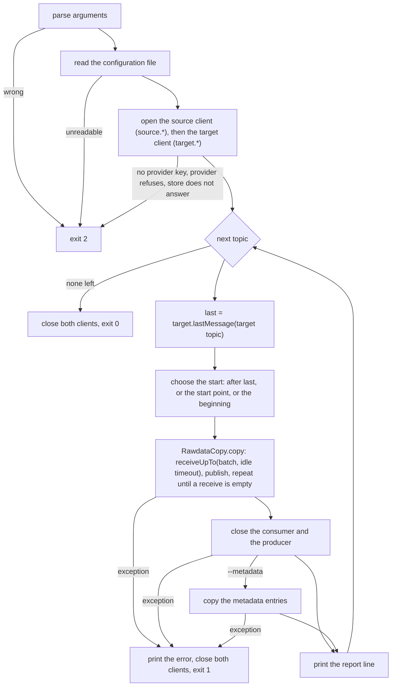

# rawdata-copy-util: the copy tool

`rawdata-copy` is a command-line tool that copies topics from one rawdata store to another. It keeps every message's
id, so the copy has the same order as the source. Use it for a backup, or to move a system from one provider or
cloud to another: `gcs` to `s3`, `filesystem` to `postgres`, one bucket to another. A copy that stopped can be run
again: it continues after the last message the target already has.

If you want to copy topics from your own Java code instead, you do not need this module: use
[`RawdataCopy.copy`](../../rawdata-client-api/src/main/java/io/descoped/rawdata/api/RawdataCopy.java) from
`rawdata-client-api`, which this tool is built on.

## Coordinates and distribution

| | |
|---|---|
| groupId | `io.descoped.rawdata` |
| artifactId | `rawdata-copy-util` |
| JPMS module | `io.descoped.rawdata.copy` (exports nothing) |
| Main class | `io.descoped.rawdata.copy.RawdataCopyTool` |
| Distributed as | `rawdata-copy-<version>.zip` on the GitHub release |

The tool is a program, not a library. It is **not** published to Maven Central and **not** in `rawdata-client-bom`:
the root POM leaves it out of the Central bundle. Each release gets a zip on its GitHub release page, built from
the release tag by the `Release` workflow (see [Releasing](../releasing.md)). No SNAPSHOT builds are published anywhere.

The zip holds one folder:

```
rawdata-copy-<version>/
  rawdata-copy-util-<version>.jar     the tool; its manifest names the main class and every jar in lib/
  lib/                                the API, all four storage providers, their dependencies, slf4j
```

Every provider is in `lib/`: `postgres`, `filesystem`, `gcs` and `s3`, plus `memory` and `discard`, which are part
of the API. You need nothing else but a Java 17 (or newer) runtime.

To build the zip from a clone of this repository:

```sh
./mvnw -pl rawdata-copy-util -am package -DskipTests
# writes rawdata-copy-util/target/rawdata-copy-<version>.zip
# and rawdata-copy-util/target/rawdata-copy-util-<version>.jar with rawdata-copy-util/target/lib/
```

## Quick start

This copies a topic from one local folder to another with the `filesystem` provider, so it needs no cloud account
and no database.

1. Unzip the distribution:

   ```sh
   unzip rawdata-copy-<version>.zip
   ```

2. Write a configuration file, `copy.properties`, with a `source.` and a `target.` part:

   ```properties
   source.rawdata.client.provider=filesystem
   source.filesystem.storage-folder=/data/rawdata
   source.local-temp-folder=/var/tmp/rawdata-copy/source

   target.rawdata.client.provider=filesystem
   target.filesystem.storage-folder=/backup/rawdata
   target.local-temp-folder=/var/tmp/rawdata-copy/target
   ```

3. Copy the topics `orders` and `events`, the second under a new name, `events-2026`:

   ```sh
   java -jar rawdata-copy-<version>/rawdata-copy-util-<version>.jar \
       --config copy.properties orders events:events-2026
   ```

   The tool prints one line per topic on standard output:

   ```
   orders -> orders: 25 messages
   events -> events-2026: 3 messages
   ```

4. Run the same command again. Nothing new has come, so nothing is copied, and the line says where the copy
   continued from:

   ```
   orders -> orders: 0 messages after 019a6f1e-5b40-7c3a-9f12-3e4d5c6b7a81
   events -> events-2026: 0 messages after 019a6f1e-5b52-7001-8a6e-0c1d2e3f4a5b
   ```

`java -jar rawdata-copy-<version>/rawdata-copy-util-<version>.jar --help` (or `-h`) prints the usage and exits with
status 0.

## Concepts

### Source and target

A run has exactly one **source** store, which it reads, and one **target** store, which it writes. Each is an
ordinary rawdata client, created with `RawdataClient.create` from its part of the configuration file. The source is
only read: the tool never publishes to it and never changes its metadata.

### The configuration file and its two parts

The configuration is one Java properties file, read as UTF-8. Every key starts with `source.` or `target.`. The tool
strips the prefix and gives each part to its own client, so after the prefix the keys are exactly those of the
provider's own configuration. `source.gcs.bucket-name` becomes the `gcs.bucket-name` of the source client. Keys with
neither prefix are ignored.

Each part must name its provider with `rawdata.client.provider` (that is, `source.rawdata.client.provider` and
`target.rawdata.client.provider`). Source and target may use the same provider, for example two buckets, or two
different ones.

Why one file with two prefixes: a copy between clouds needs two complete, independent configurations, and one file
keeps them together without any key of one side reaching the other.

### Topic arguments and renaming

Each argument that is not an option is a topic: `name` copies the topic `name` to a topic of the same name, and
`source:target` copies the topic `source` to the topic `target`. The text is split at the first colon. Both names
must be valid topic names (1 to 100 characters of `A-Z a-z 0-9 _ . -`, starting with a letter or digit; see
[Topics](../contract.md#topics)), so `a:` or `a/b` is a usage error.

Topics are copied one after the other, in the order given.

### Ids, order and the end of a topic

Rawdata ids are UUIDv7, ordered by `RawdataIds.ORDER` (see [Ids and order](../contract.md#ids-and-order)). The tool
publishes every message with its source id, in the order it reads them. The target topic therefore gets the same
messages, with the same ids, in the source's read order.

### Resuming after the target's last id

Because the ids are kept and the target is written in the source's read order, the target's last message says how
far an earlier copy came. Before it copies a topic, the tool reads the target topic's last message
(`RawdataClient.lastMessage`). If there is one, the copy starts at the first source message after that id. That is
what makes a copy safe to run again: after a failure, after a crash, or to pick up what the source received since.

The rule has a consequence that matters when you move a running system: **nothing but the tool may write to a target
topic until the last copy is done.** If something publishes to the target first, the target's last id moves past
source messages that are not copied yet, and the next copy, which starts after the last id, skips them.

### Start points: `--from-id` and `--from-time`

By default a copy starts at the beginning of the source topic. `--from-id <uuid>` starts at that id, inclusive.
`--from-time <time>` starts at the first message written at or after a time, given as an ISO-8601 instant
(`2026-11-01T00:00:00Z`, or with an offset such as `+01:00`) or as milliseconds since 1970-01-01T00:00Z. A time becomes
the id `RawdataIds.beginningOf(time)`, the smallest id of that millisecond. The two options cannot be combined.

A start point never takes the copy back before the target's end:

| Target topic | Start point given | The copy starts |
|---|---|---|
| empty | none | at the first source message |
| empty | `--from-id` or `--from-time` | at the start point, inclusive |
| has messages | none | after the target's last id |
| has messages | at or before the target's last id | after the target's last id (the start point is ignored) |
| has messages | after the target's last id | at the start point, inclusive |

In the last row, the source messages between the target's last id and the start point are not copied; the target
then has a gap compared with the source, which is what you asked for.

### Batches

The tool reads the source in batches of up to `--batch-size` messages (default 1000) and publishes each batch to the
target in one `publish` call. One call is written whole or not at all, so the target never holds part of a batch.
Memory use is bounded by one batch, plus what the target provider buffers (see below).

What a batch becomes in the target depends on the provider:

- `postgres` writes each publish in one transaction; a batch is durable when the publish returns.
- `filesystem`, `gcs` and `s3` append each publish to the topic's open upload window, an Avro file in
  `local-temp-folder`, and upload the window as one segment when it is `avro-file.max.seconds` old (default 60),
  as large as `avro-file.max.bytes` (default 64 MiB), or when the producer closes. A segment can therefore hold many
  batches. See [The upload window](rawdata-client-provider-avro.md#upload-window).

### The idle timeout: when a copy is done

A source topic has no "end" a reader can see: more messages may come at any time. The tool stops copying a topic when
the source has had nothing new for `--idle-timeout-ms` milliseconds (default 1000). On a source at rest that is right
after the last message. On a source that is still being written, the copy takes what is there and stops at the first
quiet second; the next run continues from there.

### Metadata

With `--metadata`, after the messages of a topic, the tool copies the topic's metadata entries: for every key in the
source, it writes the source value to the target with `put`. An entry in the target with the same key is overwritten;
the target's other entries stay. An entry removed from the source between the listing and the read is skipped.
Without `--metadata`, metadata is not touched.

Metadata often holds an application's checkpoints, so a move copies it in its final run, after the producers have
stopped, to bring the latest checkpoints along.

### Exit status

| Status | Constant | Meaning |
|---|---|---|
| 0 | `RawdataCopyTool.OK` | every topic was copied (also after `--help`) |
| 1 | `RawdataCopyTool.FAILED` | a copy failed or was interrupted; the topics before it were copied; run again to continue |
| 2 | `RawdataCopyTool.USAGE` | wrong arguments or configuration, or a store that cannot be opened; nothing was copied |

Scripts can rely on these: retry on 1, fix the command on 2.

## How it works



Step by step, for each run:

1. **Arguments.** Options and topics are parsed and checked: `--config` is required, at least one topic must be
   named, numbers must be positive, `--from-id` must be a UUIDv7. A mistake prints `rawdata-copy: <reason>` and the
   usage on standard error, and the tool exits with 2.
2. **Configuration.** The file is read as UTF-8 properties and split into its `source.` and `target.` parts. A part
   without `rawdata.client.provider` is a usage error that names the missing key.
3. **Clients.** The source client is created, then the target client. Any exception from a provider here (an unknown
   provider, a missing required key, a database that does not answer) is reported as
   `Cannot open the source store: ...` or `Cannot open the target store: ...`, with exit status 2.
4. **Per topic.** For each topic in the order given:
   1. The target topic's last message is read. The start rule in the table above picks where the source consumer
      starts: exclusively after the target's last id, inclusively at a start point, or at the beginning.
   2. `RawdataCopy.copy(consumer, producer, batchSize, idleTimeout)` pulls batches with `receiveUpTo` and publishes
      each with the source ids, until a receive returns nothing within the idle timeout.
   3. The consumer and the producer are closed. Closing the producer of a `filesystem`, `gcs` or `s3` target uploads
      the open window and waits for every upload of the topic, for at most `avro-file.close-timeout-seconds`
      (default 30). When it returns, everything copied is visible and durable in the target.
   4. With `--metadata`, the entries are copied.
   5. One report line goes to standard output.
5. **The end.** Both clients are closed, the target first, and the tool exits.

The first failure ends the run. The error goes to standard error as
`rawdata-copy: <source> -> <target>: copy failed; run again to continue: <exception>`, and the topics after it are not
tried. Topics before it are complete. In the failed topic, every batch that was published is in the target (or in the
target's upload buffer, see below), and the next run continues after it.

### The report line

```
<source> -> <target>: <n> messages[ after <id> | from <id>][, <m> metadata entries]
```

- `after <id>`: the copy continued after the target's last id.
- `from <id>`: the copy started at a start point; for `--from-time` the id is `RawdataIds.beginningOf(time)`.
- Neither: the copy started at the beginning of the source topic.
- `, <m> metadata entries`: only with `--metadata`.

The words are singular for 1 (`1 message`, `1 metadata entry`).

### One writer per topic

Only one process writes a topic (see [One writer per topic](../contract.md#one-writer-per-topic)). During a copy, that
process is the tool. If another process writes the target topic while the tool copies it, the target provider detects
it on the next publish and throws `RawdataWriterConflictException`; the tool reports the copy as failed (status 1).
The source may have its own writer while you copy: the tool only reads it.

### Visibility of the source

The tool copies what the source shows to a reader. For a `filesystem`, `gcs` or `s3` source, messages still in the
source producer's upload window are not visible yet, so a copy taken while the source is written may end before the
last messages the application published. The next run takes them. This is why a move ends with a run after the
producers have stopped (and closed, which uploads their windows).

## Moving a running system to another store or cloud

1. Copy every topic while the old system runs. Add `--metadata` to bring checkpoints and other metadata along.
2. Stop the producers on the old store, and let them close, so their last messages are written.
3. Run the same copy again, with `--metadata`. It copies only what came since, and the latest metadata.
4. Point the producers, and then the consumers, at the new store.

Nothing may write to a target topic before the copy of step 3 is done (see
[Resuming after the target's last id](#resuming-after-the-targets-last-id)). Steps 1 and 3 can each be run as often as
needed; a run that fails is simply run again.

An example between clouds, from a GCS bucket to PostgreSQL:

```properties
# copy.properties
source.rawdata.client.provider=gcs
source.gcs.bucket-name=my-bucket
source.gcs.credential-provider=application-default
source.local-temp-folder=/var/tmp/rawdata-copy/source

target.rawdata.client.provider=postgres
target.postgres.driver.host=db.example.com
target.postgres.driver.user=rdc
target.postgres.driver.password=secret
target.postgres.driver.database=rdc
```

```sh
java -jar rawdata-copy-<version>/rawdata-copy-util-<version>.jar --config copy.properties --metadata topic-a topic-b:renamed
```

The `gcs`, `filesystem` and `s3` providers need `local-temp-folder` even when they are only read, because the client
checks its configuration when it is created.

## Running it

On the class path, which is the usual way:

```sh
java -jar rawdata-copy-<version>/rawdata-copy-util-<version>.jar --config copy.properties topic-a
```

On the module path, as the named module `io.descoped.rawdata.copy`, which finds the providers through the API
module's `uses`:

```sh
java -p rawdata-copy-<version>/rawdata-copy-util-<version>.jar:rawdata-copy-<version>/lib \
    -m io.descoped.rawdata.copy/io.descoped.rawdata.copy.RawdataCopyTool --config copy.properties topic-a
```

Give the JVM a heap that fits the target: a `filesystem`, `gcs` or `s3` target holds each running upload in memory,
up to
`avro-file.upload.max-concurrency` × `avro-file.max.bytes` (1 GiB at the defaults), for example `java -Xmx2g -jar ...`,
or lower those keys in the `target.` part.

## Configuration

### Options

| Option | Default | Meaning |
|---|---|---|
| `--config <file>` | required | the properties file with the `source.` and `target.` parts |
| `--metadata` | off | also copy each topic's metadata entries, overwriting target entries with the same key |
| `--from-id <uuid>` | the beginning | start at this id, inclusive; must be a UUIDv7 |
| `--from-time <time>` | the beginning | start at this time: an ISO-8601 instant or epoch milliseconds |
| `--batch-size <n>` | `1000` | the most messages per publish to the target; 1 to 2147483647 |
| `--idle-timeout-ms <ms>` | `1000` | stop a topic when the source has had nothing new for this long; 1 to 2147483647 |
| `--help`, `-h` | | print the usage and exit with 0 |
| `<topic>` or `<source>:<target>` | at least one | the topics to copy, in order |

An option's value cannot start with `--`, so `--config --metadata a` is a usage error rather than a file named
`--metadata`. Any other argument that starts with `-` is an unknown option.

### The configuration file

| Key | Meaning |
|---|---|
| `source.rawdata.client.provider` | required: the source provider, `postgres`, `filesystem`, `gcs`, `s3`, `memory` or `discard` |
| `source.<key>` | the source provider's key `<key>` |
| `target.rawdata.client.provider` | required: the target provider |
| `target.<key>` | the target provider's key `<key>` |

The keys of each provider, with their defaults, are on its page: [postgres](rawdata-client-provider-postgres.md),
[filesystem](rawdata-client-provider-filesystem.md), [gcs](rawdata-client-provider-gcs.md),
[s3](rawdata-client-provider-s3.md), and the [upload window](rawdata-client-provider-avro.md#upload-window) keys that
`filesystem`, `gcs` and `s3` share. The most common:

| Provider | Keys (after the prefix) |
|---|---|
| `postgres` | `postgres.driver.host` (`localhost`), `postgres.driver.port` (`5432`), `postgres.driver.user`, `postgres.driver.password`, `postgres.driver.database` |
| `filesystem` | `filesystem.storage-folder`, `local-temp-folder` |
| `gcs` | `gcs.bucket-name`, `gcs.credential-provider`, `local-temp-folder` |
| `s3` | `s3.bucket-name`, `s3.region`, `local-temp-folder`; credentials from the AWS SDK's default chain |

The file is a `java.util.Properties` file: a backslash is an escape character, so a Windows path is written with
`\\` or with forward slashes. A password in the file is in plain text; keep the file readable by you only.

### Logging

The tool writes its own report to standard output and its errors to standard error; it does not use a logger for
them. The libraries it runs log through slf4j to `slf4j-simple`:

- `System.Logger` (the rawdata providers) through `slf4j-jdk-platform-logging`;
- `java.util.logging` (the PostgreSQL driver) through `jul-to-slf4j`, which the tool installs once per JVM on the
  root logger in place of its console handler;
- slf4j directly (HikariCP, Avro, the AWS SDK).

The bundled `simplelogger.properties` sets:

| Property | Value | Meaning |
|---|---|---|
| `org.slf4j.simpleLogger.defaultLogLevel` | `warn` | warnings and errors only |
| `org.slf4j.simpleLogger.logFile` | `System.err` | log lines go to standard error, not into the report |

A system property overrides them, for example to see what the providers do:

```sh
java -Dorg.slf4j.simpleLogger.defaultLogLevel=info -jar rawdata-copy-<version>/rawdata-copy-util-<version>.jar ...
```

## Failure modes and troubleshooting

**Exit 2, `--config is required`, `Name at least one topic`, `Unknown option`, `needs a value`.** The command line is
wrong. The usage follows the message.

**Exit 2, `--from-id is not a UUIDv7`.** Rawdata ids are UUIDv7. Take the id from a message (`RawdataMessage.id()`) or
a report line, or use `--from-time`.

**Exit 2, `The configuration has no target.rawdata.client.provider`.** A part of the file is missing or its prefix is
misspelt. Every source key starts with `source.` and every target key with `target.`.

**Exit 2, `Cannot open the source store: ...` or `Cannot open the target store: ...`.** The provider refused its part
of the configuration (an unknown provider name, a missing required key such as `local-temp-folder` or
`postgres.driver.user`, a malformed number), or the store did not answer when the client was created. The rest of the
message is the provider's.

**Exit 1, `<topic>: copy failed; run again to continue: ...`.** Something failed during the copy of that topic: a
read, a publish, an upload, or a metadata `put`. Fix the cause and run the same command again; it continues after
what the target has. Typical causes:

- `RawdataWriterConflictException`: another process wrote the target topic. Find and stop it; there must be one
  writer.
- A `RawdataException` from closing an Avro-engine producer: the uploads did not finish within
  `avro-file.close-timeout-seconds`. The windows not uploaded stay in the target's `local-temp-folder` and are
  uploaded by the next run.
- `IllegalArgumentException` from a metadata `put`: the key is longer than the target allows, for example a key over
  127 bytes copied from `postgres` to `filesystem` (see [Metadata](../contract.md#metadata)). The messages are
  copied; copy without `--metadata`, or shorten the keys in the source.
- Messages copied twice into a `filesystem`, `gcs` or `s3` target: after a crash of a run, the next run reads the
  target's end before its first publish, and that publish first uploads the windows the crashed run left behind, so
  the messages in them are copied again. Ids are not checked for duplicates, as in 2.x. A `postgres` target refuses
  the duplicate ids with `RawdataException`; run again, and it starts after them.

**Exit 1, `interrupted; run again to continue`.** The thread was interrupted while it waited for the source.

**The process was killed (Ctrl-C, a timeout, an out-of-memory error).** The tool registers no shutdown hook. A
`postgres` target has every batch that was published. A `filesystem`, `gcs` or `s3` target may have batches in its
upload buffer that were not uploaded yet. They are not lost: the next writer of the topic uploads them when it
starts, as long as it uses the **same** `target.local-temp-folder`. Keep that folder on a disk that survives the
run, and do not point a second process at it at the same time (it is locked).

**`0 messages` where you expected some.** Check:

- the target already had the messages: the line says `after <id>`;
- the source part points at the right store. A `filesystem` source creates a missing `filesystem.storage-folder`,
  so a misspelt path reads as empty topics rather than failing;
- the source messages are visible: an Avro-engine source shows a message only once its producer uploaded it;
- a start point after the last source message.

**A copy stops while the source is still busy.** The idle timeout ended it: the source had nothing new for
`--idle-timeout-ms`. That is by design; run again later, or raise the timeout.

**`The buffer folder ... is in use by another client`.** Another process (or another client in the same JVM) writes
the same topic with the same `local-temp-folder`. Give each process its own folder, and make sure only one writes
the topic.

**A stack trace instead of a `rawdata-copy:` line.** An exception from closing a client at the end of the run is not
caught by the tool; Java prints it and exits with status 1. Run again: the copy continues after what the target has.

## Testing

### How the module is tested

[`RawdataCopyToolTest`](../../rawdata-copy-util/src/test/java/io/descoped/rawdata/copy/RawdataCopyToolTest.java) runs
`RawdataCopyTool.run` with in-memory output streams and checks the exit status, the report and the target:

- copying two topics, one renamed, keeps every id and every field, in order;
- a second run continues after the target's last id and copies only what is new, and a third copies nothing;
- metadata is copied only with `--metadata`;
- `--from-id`, `--from-time` as an instant and as epoch milliseconds start where they should;
- a start point later than the target's last id wins, and an earlier one is ignored;
- a copy from `filesystem` to PostgreSQL 18 (`postgres:18-alpine` through Testcontainers) keeps every field;
- wrong arguments, a missing target part, an unknown provider and an incomplete provider configuration are usage
  errors (status 2);
- a damaged source segment fails that topic with status 1, after the topics before it were copied;
- `java.util.logging` is bridged to slf4j once, with one handler on the root logger.

The tests run on the class path, because Testcontainers' dependencies are automatic modules with split packages, and
need Docker for the PostgreSQL test:

```sh
JAVA_HOME=<a JDK 17> ./mvnw -pl rawdata-copy-util -am verify
```

The module depends on every provider, so with `-P coverage` it also writes the aggregate JaCoCo report for the whole
reactor (`rawdata-copy-util/target/site/jacoco-aggregate`). See [Building and testing](../building-and-testing.md).

### Testing your own copy

- **Try the configuration first on a local target.** Point `target.` at a `filesystem` folder, copy, and read the
  result with a client, or compare counts. The same command works against the real target afterwards.
- **Check the source without writing anything.** Use `target.rawdata.client.provider=discard`: every publish is
  accepted and nothing is kept, so the report gives the number of messages the source shows. A discard target is
  always empty, so the copy always starts at the beginning.
- **Script it on the exit status.** 0 is done, 1 is worth a retry, 2 needs a fix.
- **In Java code**, copy with `RawdataCopy.copy` and test it with the `memory` provider, as with any other rawdata
  code (see [rawdata-client-api](rawdata-client-api.md)).

## Reference

| Type | Member | |
|---|---|---|
| [`RawdataCopyTool`](../../rawdata-copy-util/src/main/java/io/descoped/rawdata/copy/RawdataCopyTool.java) | `public static void main(String[] args)` | runs the tool and exits the JVM with its status |
| | `public static int run(String[] args, PrintStream out, PrintStream err)` | runs the tool and returns its status; the report goes to `out`, errors and usage to `err` |
| | `public static final int OK = 0` | every topic was copied |
| | `public static final int FAILED = 1` | a copy failed; run again to continue |
| | `public static final int USAGE = 2` | wrong arguments or configuration, or a store that cannot be opened |
| [`RawdataCopy`](../../rawdata-client-api/src/main/java/io/descoped/rawdata/api/RawdataCopy.java) (API) | `public static long copy(RawdataConsumer from, RawdataProducer to, int batchSize, Duration idleTimeout) throws InterruptedException` | the copy loop the tool runs; returns the number of messages copied |

The module exports no package ([`module-info.java`](../../rawdata-copy-util/src/main/java/module-info.java)), so
`run` can be called from code only on the class path. To copy from an application, use `RawdataCopy.copy`.

Build files: [`pom.xml`](../../rawdata-copy-util/pom.xml) (the runnable jar, `lib/` and the zip),
[`distribution.xml`](../../rawdata-copy-util/src/assembly/distribution.xml) (the zip's layout),
[`simplelogger.properties`](../../rawdata-copy-util/src/main/resources/simplelogger.properties) (logging).

## See also

- [Concepts](../concepts.md): topics, messages, ids, order, metadata and providers.
- [Tutorial](../tutorial.md): a first producer and consumer.
- [The contract](../contract.md): what every provider guarantees, including [one writer per
  topic](../contract.md#one-writer-per-topic) and [copying](../contract.md#copying).
- [rawdata-client-api](rawdata-client-api.md): `RawdataClient`, `RawdataCopy`, `RawdataIds`, the `memory` and
  `discard` providers.
- The providers: [postgres](rawdata-client-provider-postgres.md), [filesystem](rawdata-client-provider-filesystem.md),
  [gcs](rawdata-client-provider-gcs.md), [s3](rawdata-client-provider-s3.md), and the Avro engine they share,
  [rawdata-client-provider-avro](rawdata-client-provider-avro.md).
- [Releasing](../releasing.md): how the zip gets onto the GitHub release.
